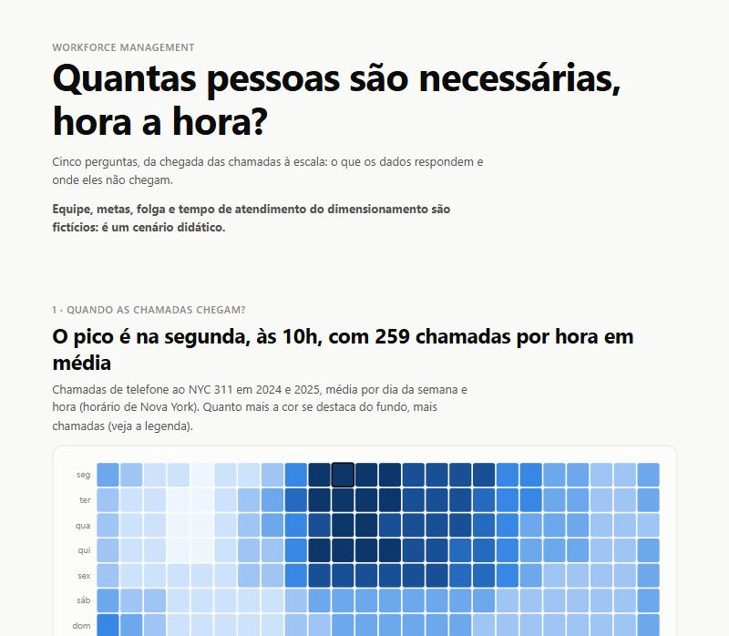
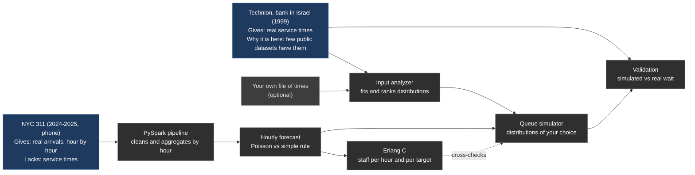
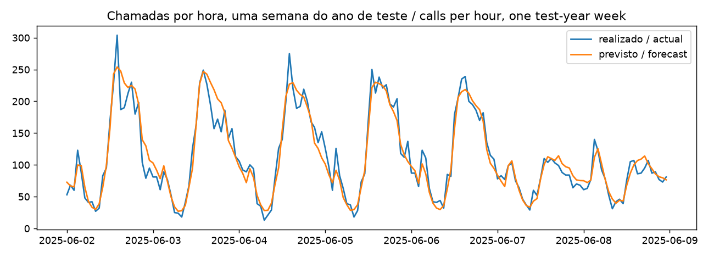
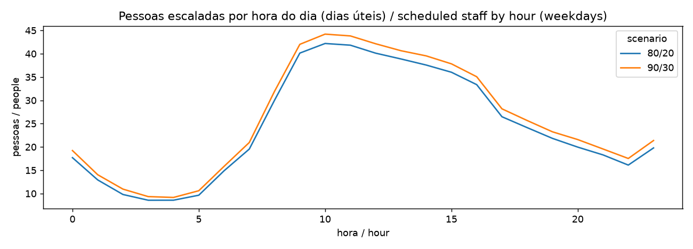
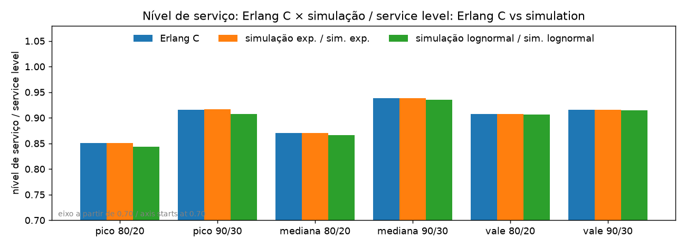
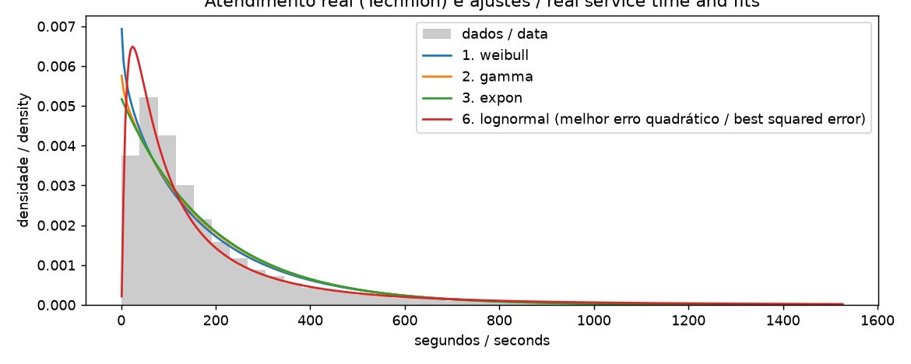
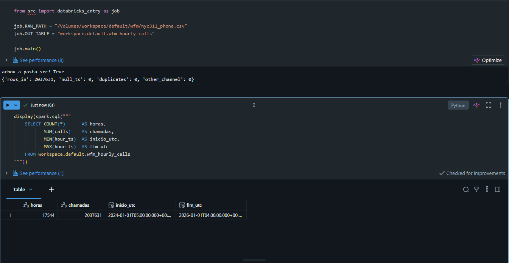

# Staffing from hourly demand forecasts

[Versão em português](README.md)

**The question:** how many people are needed, hour by hour, to answer within a target waiting time, and what happens when you hire or lose someone?

**What the project shows:** PySpark and Databricks, time series forecasting, Erlang C, distribution fitting, queue simulation, a Streamlit app, alerts and automated tests.

**See the story in interactive charts:** [open the page](https://safsalles.github.io/portfolio-ds/dimensionamento-equipe/site/) (use the English button)

**Want to play with the numbers?** [Download the Excel calculator](https://github.com/safsalles/portfolio-ds/raw/main/dimensionamento-equipe/planilha/dimensionamento_equipe.xlsx): Erlang C formulas, no macros (in Portuguese).

[](https://safsalles.github.io/portfolio-ds/dimensionamento-equipe/site/)

> **Notice:** the team, handling time, shrinkage and service targets in this project are **fictional**. It is a teaching Workforce Management (WFM) scenario. NYC 311 only supplies call arrivals; no real staffing, cost or handling-time data was used.

It shows, with running code and tests, the sizing cycle of a phone contact center: raw data → hourly PySpark aggregation → forecast → Erlang C → queue simulation → monitoring with alerts.

## Where the data comes from

<!-- FLUXO:INICIO -->

<!-- FLUXO:FIM -->

NYC 311 gives what is needed to size a team: **real arrivals, hour by hour**. But it does not record how long each contact lasts. The Technion data is one of the few public datasets with **real service times**; so it is used only for that (distribution fitting and validation). The two datasets are unrelated to each other.

## What it does

1. **PySpark pipeline** cleans and aggregates NYC 311 phone calls (NYC Open Data) by hour, filling empty hours with zero and handling daylight saving time.
2. **Hourly forecast** with hour-of-day and day-of-week seasonality (Poisson regression), compared with a simple rule (average of the last 4 weeks), always out-of-sample.
3. **Erlang C**: how many people are needed to meet a service target, in two scenarios, plus shrinkage.
4. **Queue simulation** of the same scenario, checked against Erlang C, plus a variant with less regular handling times.
5. **Intraday monitoring**: forecast vs. actual, with an alert to a test Slack webhook.
6. **Input analyzer** (in the spirit of the Arena Input Analyzer): fits nine distributions to the real service times of a bank call center (public Technion data) and to the NYC 311 arrivals, and ranks them by AIC.
7. **Customizable simulator and web app**: the user picks the arrival and service distributions, or loads their own file (optional), and compares the simulation with Erlang C. The app opens ready to use, with nothing to load.

## Results

Produced by `scripts/run_all.py` and copied from `results/results.json` by `scripts/atualizar_readme.py`. A test checks that nothing here was edited by hand.

<!-- RESULTADOS:INICIO -->
### Data

- Source: NYC 311 Service Requests (NYC Open Data), canal PHONE
- Train / test: 2024 / 2025
- Rows read (all phone channel, no nulls or duplicates): 2,037,631
- Hours in the series: 17,544

### Hourly forecast (test year, out-of-sample)

| Method | WAPE | MAPE |
|---|---:|---:|
| Simple rule (average of the last 4 weeks) | 20.0% | 27.1% |
| Poisson model, fitted once on the training year | 25.7% | 37.2% |
| Poisson model, refitted every month with past data only | 19.8% | 28.3% |

Gain of the refitted model over the rule (WAPE): 1.1%

### Staff required per scenario (fictional assumptions)

| Scenario | Agent-hours present | Agent-hours scheduled (with shrinkage) | Peak present | Peak scheduled |
|---|---:|---:|---:|---:|
| 80/20 | 135,685 | 197,442 | 35 | 50 |
| 90/30 | 144,638 | 210,309 | 36 | 52 |

Fictional assumptions used: 360 s handling time and 30% shrinkage.

### Queue simulation × Erlang C (service level)

| Hour | Scenario | Forecast calls/h | Agents | Erlang C | Simulation (exponential service) | Simulation (lognormal service) |
|---|---|---:|---:|---:|---:|---:|
| peak | 80/20 | 290.3 | 35 | 85.1% | 85.1% | 84.4% |
| peak | 90/30 | 290.3 | 36 | 91.5% | 91.6% | 90.7% |
| median | 80/20 | 99.0 | 14 | 87.0% | 87.0% | 86.6% |
| median | 90/30 | 99.0 | 15 | 93.8% | 93.8% | 93.5% |
| valley | 80/20 | 38.1 | 7 | 90.8% | 90.8% | 90.6% |
| valley | 90/30 | 38.1 | 7 | 91.5% | 91.5% | 91.4% |

### Input analyzer: service times (real Technion data)

351,893 real served calls (100,000 used in the fit, random sample with a fixed seed). Ranking criterion fixed before running: AIC (lower is better).

| Rank | Distribution | AIC | BIC | KS | Squared error | Parameters |
|---:|---|---:|---:|---:|---:|---|
| 1 | weibull | 1,251,181 | 1,251,200 | 0.068 | 0.82e-4 | shape=0.937; scale=186.144 |
| 2 | gamma | 1,251,957 | 1,251,976 | 0.066 | 1.00e-4 | mean=192.493; cv=1.015 |
| 3 | expon | 1,252,014 | 1,252,023 | 0.069 | 1.02e-4 | mean=192.493 |
| 4 | erlang | 1,252,016 | 1,252,035 | 0.069 | 1.02e-4 | k=1.000; mean=192.493 |
| 5 | beta | 1,253,910 | 1,253,948 | 0.070 | 1.16e-4 | low=0.000; high=15,731.750; a=0.947; b=75.654 |
| 6 | lognormal | 1,255,886 | 1,255,905 | 0.077 | 0.11e-4 | mean=222.530; cv=1.846 |
| 7 | normal | 1,403,461 | 1,403,480 | 0.239 | 35.45e-4 | mean=192.493; sd=269.979 |
| 8 | triangular | 1,796,555 | 1,796,584 | 0.875 | 101.01e-4 | low=0.000; mode=1.000; high=15,731.750 |
| 9 | uniform | 1,932,691 | 1,932,710 | 0.921 | 105.42e-4 | low=0.000; high=15,731.750 |

Proposed distribution (best AIC): **weibull**. By squared error the best is **lognormal**: the criteria do not agree. The exponential, Erlang C's assumption, ranked 3 by AIC. With hundreds of thousands of points any goodness-of-fit test rejects every candidate, so the p-value is not used to decide.

### Input analyzer: NYC 311 arrivals (gaps between calls, weekdays)

| Band | Gaps (total) | Used in the fit | 1st | 2nd | 3rd |
|---|---:|---:|---|---|---|
| 0-6h | 148,438 | 100,000 | gamma | beta | weibull |
| 9-17h | 912,893 | 100,000 | beta | gamma | weibull |
| 18-24h | 310,014 | 100,000 | beta | gamma | weibull |

Each band mixes hours with different rates, so non-exponential gaps are expected; on its own that does not refute Poisson arrivals.

### Validation against the real bank (Technion)

| Metric | Real | Simulated |
|---|---:|---:|
| Mean wait (s) | 89.2 | 41.1 |
| Answered within 20 s | 37.4% | 73.1% |

Window: bank weekdays, 10h to 11h; 27,624 served calls over 251 days; 8 agents in the simulation; real abandonment in the window: 22.8%.

How many agents make the simulation look like the bank? (calibration)

| Agents | Simulated mean wait (s) | Answered within 20 s (simulated) |
|---:|---:|---:|
| 4 | 947.6 | 10.8% |
| 5 | 479.7 | 20.8% |
| 6 | 228.1 | 37.7% |
| 7 | 101.1 | 56.6% |
| 8 | 41.1 | 73.1% |
| 9 | 15.7 | 85.2% |
| 10 | 6.0 | 92.6% |
| 11 | 2.3 | 96.6% |
| 12 | 0.9 | 98.6% |

With **7** agents the simulation gets closest to the bank's real wait. This is a **calibration**: that number is not how many people the bank had, nor proof that the model is right. The reason for the gap has not been established, and the simulation starts with an empty queue at the beginning of the window, which makes it more optimistic.

### Why doesn't the simulation reproduce the bank? (investigation)

Bank weekdays, 10h to 11h, 27,624 served calls. Each step was a test, in the order it was run; the numbers come from `scripts/investigar_espera.py`. Gap A: time until the agent takes the next call when that caller was already waiting. Gap B: the same, with someone in the queue during the whole gap.

| Scenario | Mean wait (s) | Answered within 20 s | Median (s) |
|---|---:|---:|---:|
| Real | 89.2 | 37.4% | 46 |
| 8 fixed | 55.5 | 67.5% | 0 |
| Measured agents (present in the hour) | 13.9 | 90.9% | 0 |
| Measured agents (shift) | 5.6 | 95.4% | 0 |
| 8 fixed + gap A | 85.3 | 60.4% | 0 |
| 8 fixed + gap B | 184.2 | 46.7% | 36 |
| Measured + gap A | 20.1 | 87.7% | 0 |
| Measured + gap B | 41.9 | 79.8% | 0 |
| Measured with breaks of 2 min or more | 133.1 | 57.8% | 0 |
| Measured with breaks of 2 min or more + gap A | 184.2 | 49.4% | 22 |
| Measured with breaks of 5 min or more | 107.0 | 64.1% | 0 |
| Measured with breaks of 5 min or more + gap A | 144.7 | 55.7% | 2 |
| Measured with breaks of 10 min or more | 73.7 | 72.3% | 0 |
| Measured with breaks of 10 min or more + gap A | 96.7 | 65.1% | 0 |

1. **Empty positions: hypothesis refuted.** The first explanation was that not all 8 positions were staffed. The data shows 9.4 agents present on average in the window, and simulating with them makes the wait even shorter.
2. **Gap between calls: explains little.** With a caller waiting, the mean gap was 10.4 s (A) and 29.0 s (B). Added to every call on top of the measured agents, the simulation stays below half of the real wait.
3. **Breaks as blocks: they explain the order of magnitude, not the shape.** Removing the agent during breaks (main cut-off 5 min; 2 and 10 min as sensitivity) takes available agents from 9.4 to 7.4 and the mean wait to 107.0 s. The share answered within target and the median stay far from the real ones, the result depends heavily on the cut-off, and there is circularity: the breaks come from the very day being simulated.
4. **Fixed delay with idle agents: not found.** For calls with nobody ahead and at most half of the agents busy (27.3% of calls between 7h and 24h), the median wait was 0 s (mean 11.1 s). The criterion set beforehand, a median of at least 10 s, was not met.

**Conclusion:** the reason for the gap has not been established. For staffing, counting only the people present underestimates the wait, and how breaks are treated changes the result a lot. Not tested: breaks learned from other months (the only one of these that would be a forecast test) and abandonment. Table combinations that get close to the real mean are not treated as an explanation, because they miss the share answered and the median.

**Mixed sources:** the default scenario uses NYC 311 arrivals and Technion service times; the two datasets are unrelated to each other.

Declared tolerance between simulation and Erlang C: 0.02. Lognormal service coefficient of variation: 1.5.

### Intraday monitoring

- Deviation threshold for an alert: 30%
- Hours compared: 8,760
- Hours in alert: 2,051
- Day with most alerts: 2025-11-11
- Slack webhook configured in this run: no
<!-- RESULTADOS:FIM -->

## Figures







### How to read it

- **Forecast:** fitting once on the training year loses to the simple rule, probably because the test year's volume shifted level (the monthly refit, which corrects that, closes the gap). Refitting every month using only earlier data, the model **roughly ties** the rule: the WAPE gain is small and on MAPE the model loses. With this much hourly variation, the simple rule is a strong baseline. Nothing was tuned by looking at the test year.
- **Simulation × Erlang C:** with exponential handling times, which is Erlang C's assumption, the values match within the declared tolerance. With more irregular handling times, the simulation shows a slightly lower real service level than Erlang C.
- **Alerts:** with a fixed deviation threshold and low-volume hours, part of the alerts is probably counting noise; hence a minimum forecast volume.

## App and customizable simulator



`powershell
streamlit run app/app.py
`

The app opens with the default scenario already simulated: NYC 311 arrivals and the proposed service distribution (best AIC on the real Technion service times), with the full ranking in view. You can change the service and arrival distributions, their parameters, the team and the target, and see the simulated service level next to Erlang C (which only holds for exponential service and Poisson arrivals).

- **Nobody has to load anything:** the example data ships with the repository (`data/exemplos/`). A test runs the app in a folder without `data/raw` and without the Parquet files.
- **Your own file (optional):** a CSV with one column of times in seconds (header and decimal comma accepted). The app fits and ranks the distributions and lets you use the chosen one in the scenario.
- **From the command line:** `python -m src.scenario config/cenario_exemplo.yaml` runs a scenario described in YAML.
- **Sources and terms:** `data/exemplos/FONTES.md`. The Technion data is free to use, provided the source is cited and Professor Avi Mandelbaum is notified; the notice was sent on 25/11/2026 (no reply recorded so far).

## Run on Databricks

The pipeline was **run on Databricks Free Edition** (serverless compute) on 25/11/2026; **only the pipeline**: forecast, Erlang C, simulation and app remain local. The raw CSV was uploaded to a Volume, `src/databricks_entry.py` called the same `clean_and_aggregate` function used locally, wrote the table `workspace.default.wfm_hourly_calls`, and the totals were checked in SQL.

| Check | Local | Databricks |
|---|---:|---:|
| Rows read | 2,037,631 | 2,037,631 |
| Hours in the table | 17,544 | 17,544 |
| Calls summed | 2,037,631 | 2,037,631 |



## Limits and honesty

- The ticket opening time is treated as the contact arrival time. It is an approximation.
- Erlang C assumes Poisson arrivals, exponential handling times and no abandonment.
- Spark only writes the aggregated result; Parquet is written by pandas because Spark on Windows would need an external binary (`winutils.exe`).
- **Databricks:** only the pipeline ran there (see above). There is no scheduled job, no persisted intermediate layer and no cluster tuning.
- The simulator does not model queue abandonment. In the real bank part of the customers hang up, and the simulation does not reproduce the bank's real waiting time (see the validation above); breaks and after-call work are also left out, and the reason for the gap has not been established.
- No Datadog or Salesforce integration.

## How to run

Requires Python 3.12 and Java 17 (for PySpark; set `JAVA_HOME`).

```powershell
pip install -r requirements.txt
python scripts/download_311.py 2024-01-01 2025-12-31 data/raw/nyc311_phone.csv
python scripts/run_all.py
# optional: rebuild the Technion extract from the original file (data/raw/technion)
python scripts/preparar_technion.py data/raw/technion data/exemplos/technion_chamadas.csv.gz
python scripts/analisar_entradas.py
# needs the original Technion files in data/raw/technion
python scripts/investigar_espera.py
python scripts/atualizar_readme.py
python scripts/gerar_figuras.py
python scripts/gerar_pagina.py
python scripts/gerar_planilha.py
pytest
streamlit run app/app.py
```

To send real alerts, set `SLACK_WEBHOOK_URL` to a test webhook URL (never put the URL in code). On computers whose name has an accent, `build_spark` already pins the address to `127.0.0.1`.

## Layout

`src/` (pipeline, forecast, Erlang C, simulation, staffing, monitor), `tests/` (pytest), `scripts/` (download and run), `config/premissas.yaml` (fictional assumptions), `notebooks/analise.ipynb`, `app/` (Streamlit app), `data/exemplos/` (small extracts and `FONTES.md`), `results/` (outputs).


