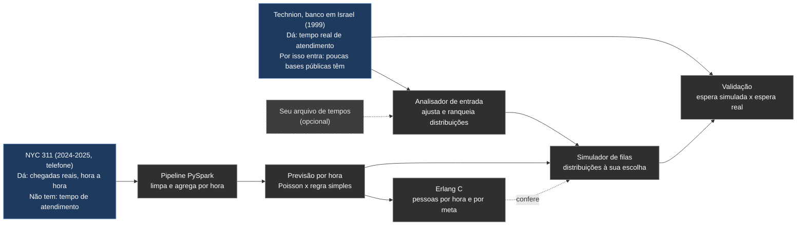
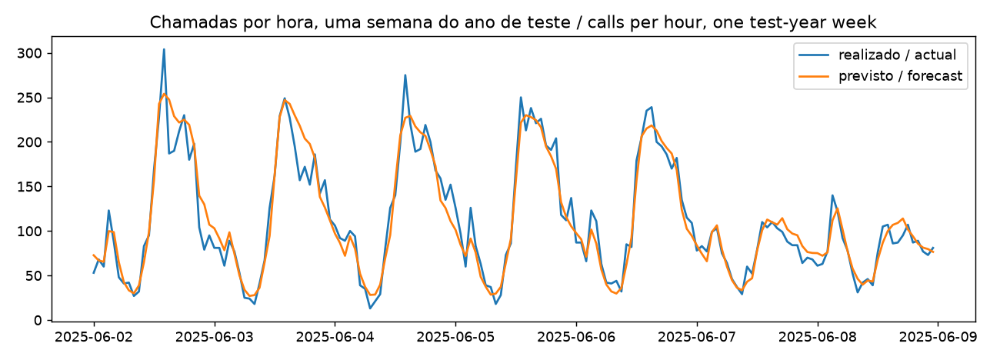
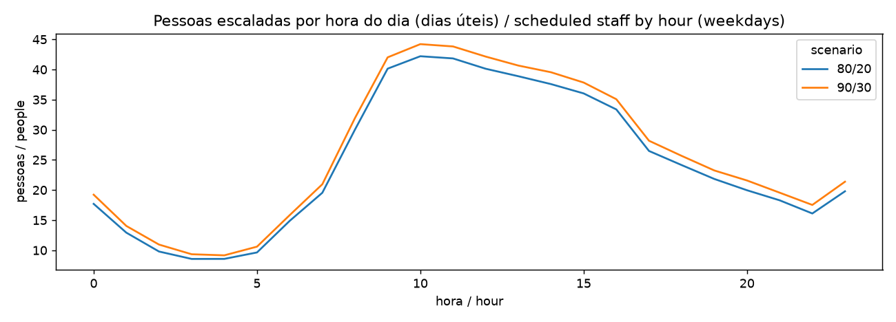
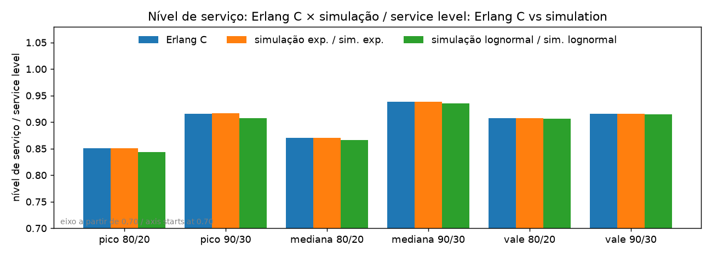
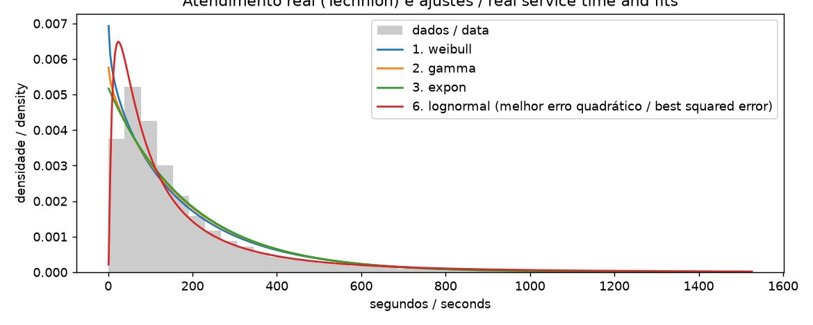
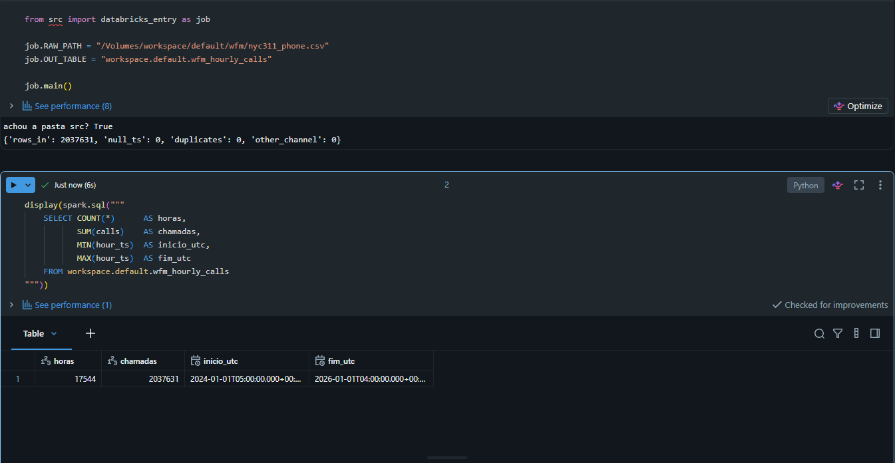

# Dimensionamento de equipe a partir da previsão de demanda por hora

[English version](README.en.md)

**A pergunta:** quantas pessoas são necessárias, hora a hora, para atender dentro de um tempo de espera alvo, e o que acontece quando se contrata ou se perde alguém?

**O que o projeto demonstra:** PySpark e Databricks, previsão de séries temporais, Erlang C, ajuste de distribuições, simulação de filas, app em Streamlit, alertas e testes automatizados.

**Veja a história em gráficos interativos:** [abrir a página](https://safsalles.github.io/portfolio-ds/dimensionamento-equipe/site/)

[](https://safsalles.github.io/portfolio-ds/dimensionamento-equipe/site/)

> **Aviso:** a equipe, o tempo de atendimento, a folga e as metas de serviço deste projeto são **fictícios**. É um cenário didático de Workforce Management (WFM). O NYC 311 fornece só as chegadas de chamadas; nenhum dado real de pessoal, custo ou tempo de atendimento foi usado.

Mostra, com código que roda e testes, o ciclo de dimensionamento de uma central telefônica: dado bruto → agregação por hora em PySpark → previsão → Erlang C → simulação de filas → monitoramento com alerta.

## De onde vêm os dados

<!-- FLUXO:INICIO -->

<!-- FLUXO:FIM -->

O NYC 311 dá o que falta para dimensionar uma equipe: **chegadas reais, hora a hora**. Mas ele não registra quanto dura cada atendimento. A base do Technion é uma das poucas públicas com **tempo real de atendimento**; por isso entra só para isso (ajuste de distribuição e validação). As duas bases não têm relação entre si.

## O que faz

1. **Pipeline PySpark** limpa e agrega as chamadas de telefone do NYC 311 (NYC Open Data) por hora, com horas vazias preenchidas com zero e horário de verão tratado.
2. **Previsão por hora** com sazonalidade por hora e dia da semana (regressão de Poisson), comparada com uma regra simples (média das 4 semanas), sempre fora da amostra.
3. **Erlang C**: quantas pessoas são necessárias para cumprir uma meta de serviço, em dois cenários, mais a folga para ausências.
4. **Simulação de filas** do mesmo cenário, conferida contra o Erlang C, e uma variação com atendimento menos regular.
5. **Monitoramento intraday**: previsto contra realizado, com alerta por webhook de teste do Slack.
6. **Analisador de entrada** (no estilo do Input Analyzer do Arena): ajusta nove distribuições aos tempos reais de atendimento de um call center de banco (base pública do Technion) e às chegadas do NYC 311, e ranqueia por AIC.
7. **Simulador customizável e app web**: o usuário escolhe a distribuição das chegadas e do atendimento, ou carrega o próprio arquivo (opcional), e compara a simulação com o Erlang C. O app abre já pronto, sem carregar nada.

## Resultados

Gerados por `scripts/run_all.py` e copiados de `results/results.json` por `scripts/atualizar_readme.py`. Um teste confere que nada aqui foi editado à mão.

<!-- RESULTADOS:INICIO -->
### Dados

- Fonte: NYC 311 Service Requests (NYC Open Data), canal PHONE
- Treino / teste: 2024 / 2025
- Linhas lidas (todas no canal telefone, sem nulos nem duplicadas): 2.037.631
- Horas na série: 17.544

### Previsão por hora (ano de teste, medida fora da amostra)

| Método | WAPE | MAPE |
|---|---:|---:|
| Regra simples (média das 4 semanas) | 20,0% | 27,1% |
| Modelo Poisson, ajuste único no ano de treino | 25,7% | 37,2% |
| Modelo Poisson, reajustado todo mês só com dados passados | 19,8% | 28,3% |

Ganho do modelo reajustado sobre a regra (WAPE): 1,1%

### Pessoas necessárias por cenário (premissas fictícias)

| Cenário | Pessoas-hora presentes | Pessoas-hora escaladas (com folga) | Pico presentes | Pico escaladas |
|---|---:|---:|---:|---:|
| 80/20 | 135.685 | 197.442 | 35 | 50 |
| 90/30 | 144.638 | 210.309 | 36 | 52 |

Premissas fictícias usadas: atendimento de 360 s e folga de 30%.

### Simulação de filas × Erlang C (nível de serviço)

| Hora | Cenário | Chamadas/h previstas | Agentes | Erlang C | Simulação (atend. exponencial) | Simulação (atend. lognormal) |
|---|---|---:|---:|---:|---:|---:|
| pico | 80/20 | 290,3 | 35 | 85,1% | 85,1% | 84,4% |
| pico | 90/30 | 290,3 | 36 | 91,5% | 91,6% | 90,7% |
| mediana | 80/20 | 99,0 | 14 | 87,0% | 87,0% | 86,6% |
| mediana | 90/30 | 99,0 | 15 | 93,8% | 93,8% | 93,5% |
| vale | 80/20 | 38,1 | 7 | 90,8% | 90,8% | 90,6% |
| vale | 90/30 | 38,1 | 7 | 91,5% | 91,5% | 91,4% |

### Analisador de entrada: tempo de atendimento (base real do Technion)

351.893 atendimentos reais (100.000 usados no ajuste, amostra aleatória com semente fixa). Critério de ordenação definido antes de rodar: AIC (menor é melhor).

| Posição | Distribuição | AIC | BIC | KS | Erro quadrático | Parâmetros |
|---:|---|---:|---:|---:|---:|---|
| 1 | weibull | 1.251.181 | 1.251.200 | 0,068 | 0,82e-4 | shape=0,937; scale=186,144 |
| 2 | gamma | 1.251.957 | 1.251.976 | 0,066 | 1,00e-4 | mean=192,493; cv=1,015 |
| 3 | expon | 1.252.014 | 1.252.023 | 0,069 | 1,02e-4 | mean=192,493 |
| 4 | erlang | 1.252.016 | 1.252.035 | 0,069 | 1,02e-4 | k=1,000; mean=192,493 |
| 5 | beta | 1.253.910 | 1.253.948 | 0,070 | 1,16e-4 | low=0,000; high=15.731,750; a=0,947; b=75,654 |
| 6 | lognormal | 1.255.886 | 1.255.905 | 0,077 | 0,11e-4 | mean=222,530; cv=1,846 |
| 7 | normal | 1.403.461 | 1.403.480 | 0,239 | 35,45e-4 | mean=192,493; sd=269,979 |
| 8 | triangular | 1.796.555 | 1.796.584 | 0,875 | 101,01e-4 | low=0,000; mode=1,000; high=15.731,750 |
| 9 | uniform | 1.932.691 | 1.932.710 | 0,921 | 105,42e-4 | low=0,000; high=15.731,750 |

Distribuição proposta (melhor AIC): **weibull**. Pelo erro quadrático, a melhor é **lognormal**: os critérios não concordam. A exponencial, hipótese do Erlang C, ficou em 3º lugar por AIC. Com centenas de milhares de pontos qualquer teste de aderência rejeita todas as candidatas, por isso o p-valor não é usado para decidir.

### Analisador de entrada: chegadas do NYC 311 (intervalos entre chamadas, dias úteis)

| Faixa | Intervalos (total) | Usados no ajuste | 1º | 2º | 3º |
|---|---:|---:|---|---|---|
| 0-6h | 148.438 | 100.000 | gamma | beta | weibull |
| 9-17h | 912.893 | 100.000 | beta | gamma | weibull |
| 18-24h | 310.014 | 100.000 | beta | gamma | weibull |

Cada faixa mistura horas com taxas diferentes, então intervalos que não são exponenciais são esperados; isso, sozinho, não refuta chegadas de Poisson.

### Validação com o banco real (Technion)

| Métrica | Real | Simulada |
|---|---:|---:|
| Espera média (s) | 89,2 | 41,1 |
| Atendidas em até 20 s | 37,4% | 73,1% |

Janela: dias úteis do banco, 10h às 11h; 27.624 ligações atendidas em 251 dias; 8 atendentes na simulação; abandono real na janela: 22,8%.

Quantos atendentes tornam a simulação parecida com o banco? (calibração)

| Agentes | Espera média simulada (s) | Atendidas em até 20 s (simulada) |
|---:|---:|---:|
| 4 | 947,6 | 10,8% |
| 5 | 479,7 | 20,8% |
| 6 | 228,1 | 37,7% |
| 7 | 101,1 | 56,6% |
| 8 | 41,1 | 73,1% |
| 9 | 15,7 | 85,2% |
| 10 | 6,0 | 92,6% |
| 11 | 2,3 | 96,6% |
| 12 | 0,9 | 98,6% |

Com **7** agentes a simulação chega mais perto da espera real do banco. Isso é uma **calibração**: esse número não é a quantidade de pessoas que havia no banco nem prova que o modelo está certo. O motivo da diferença não está demonstrado, e a simulação começa com a fila vazia no início da janela, o que a deixa mais otimista.

### Por que a simulação não reproduz o banco? (investigação)

Dias úteis do banco, 10h às 11h, 27.624 ligações atendidas. Cada passo foi um teste, na ordem em que foi feito; os números saem de `scripts/investigar_espera.py`. Intervalo A: tempo até o atendente pegar a próxima ligação quando o cliente já esperava. Intervalo B: o mesmo, com alguém na fila o intervalo todo.

| Cenário | Espera média (s) | Atendidas em até 20 s | Mediana (s) |
|---|---:|---:|---:|
| Real | 89,2 | 37,4% | 46 |
| 8 fixos | 55,5 | 67,5% | 0 |
| Atendentes medidos (presença na hora) | 13,9 | 90,9% | 0 |
| Atendentes medidos (turno) | 5,6 | 95,4% | 0 |
| 8 fixos + intervalo A | 85,3 | 60,4% | 0 |
| 8 fixos + intervalo B | 184,2 | 46,7% | 36 |
| Medidos + intervalo A | 20,1 | 87,7% | 0 |
| Medidos + intervalo B | 41,9 | 79,8% | 0 |
| Medidos com pausas de 2 min ou mais | 133,1 | 57,8% | 0 |
| Medidos com pausas de 2 min ou mais + intervalo A | 184,2 | 49,4% | 22 |
| Medidos com pausas de 5 min ou mais | 107,0 | 64,1% | 0 |
| Medidos com pausas de 5 min ou mais + intervalo A | 144,7 | 55,7% | 2 |
| Medidos com pausas de 10 min ou mais | 73,7 | 72,3% | 0 |
| Medidos com pausas de 10 min ou mais + intervalo A | 96,7 | 65,1% | 0 |

1. **Posições vazias: hipótese refutada.** A primeira explicação foi que nem todas as 8 posições estavam ocupadas. No dado há em média 9,4 atendentes presentes na janela, e simular com eles deixa a espera ainda menor.
2. **Intervalo entre ligações: explica pouco.** Com cliente esperando, o intervalo médio foi de 10,4 s (A) e 29,0 s (B). Somado a cada ligação sobre os atendentes medidos, a simulação continua abaixo da metade da espera real.
3. **Pausas em bloco: explicam a ordem de grandeza, não o formato.** Tirar o atendente durante as pausas (corte principal de 5 min; 2 e 10 min como sensibilidade) leva os atendentes disponíveis de 9,4 para 7,4 e a espera média para 107,0 s. A fração atendida na meta e a mediana continuam longe das reais, o resultado muda muito com o corte, e há circularidade: as pausas saem do próprio dia simulado.
4. **Atraso fixo com gente livre: não encontrado.** Nas ligações sem ninguém à frente e com no máximo metade dos atendentes ocupada (27,3% do total entre 7h e 24h), a mediana da espera foi 0 s (média 11,1 s). O critério fixado antes, mediana de pelo menos 10 s, não foi atendido.

**Conclusão:** o motivo da diferença não está demonstrado. Para quem dimensiona equipe, contar só as pessoas presentes subestima a espera, e a forma como se trata as pausas muda muito o resultado. Não testado: pausas aprendidas em outros meses (o único teste destes que seria de previsão) e abandono. Combinações da tabela que chegam perto da média real não são tratadas como explicação, porque erram a fração atendida e a mediana.

**Fontes misturadas:** o cenário padrão usa as chegadas do NYC 311 e o atendimento do Technion; as duas bases não têm relação entre si.

Tolerância declarada entre simulação e Erlang C: 0,02. Coeficiente de variação do atendimento lognormal: 1,5.

### Monitoramento intraday

- Limite de desvio para alerta: 30%
- Horas comparadas: 8.760
- Horas em alerta: 2.051
- Dia com mais alertas: 2025-11-11
- Webhook do Slack configurado nesta execução: não
<!-- RESULTADOS:FIM -->

## Figuras







### Como ler

- **Previsão:** o ajuste único no ano de treino perde da regra simples, provavelmente porque o volume do ano de teste mudou de nível (o reajuste mensal, que corrige isso, fecha a distância). Reajustando o modelo todo mês, só com dados anteriores, ele **praticamente empata** com a regra: o ganho no WAPE é pequeno e no MAPE o modelo perde. Em uma série com tanta variação por hora, a regra simples é uma referência forte. Nenhum ajuste foi feito olhando o ano de teste.
- **Simulação × Erlang C:** com atendimento exponencial, que é a hipótese do Erlang C, os valores batem dentro da tolerância declarada. Com atendimento mais irregular, a simulação mostra o nível de serviço real um pouco abaixo do Erlang C.
- **Alertas:** com limite de desvio fixo e horas de poucas chamadas, parte dos alertas provavelmente é ruído de contagem; por isso há um piso mínimo de chamadas previstas.

## App e simulador customizável



`powershell
streamlit run app/app.py
`

O app abre com o cenário padrão já simulado: chegadas do NYC 311 e atendimento com a distribuição proposta (melhor AIC nos tempos reais do Technion), com o ranking completo à vista. Dá para trocar a distribuição de atendimento e a das chegadas, mudar os parâmetros, a equipe e a meta, e ver o nível de serviço simulado ao lado do Erlang C (que só vale para atendimento exponencial e chegadas de Poisson).

- **Não depende de ninguém carregar nada:** os dados de exemplo vêm no repositório (`data/exemplos/`). Um teste roda o app numa pasta sem `data/raw` e sem os arquivos Parquet.
- **Arquivo próprio (opcional):** CSV com uma coluna de tempos em segundos (cabeçalho e vírgula decimal são aceitos). O app ajusta e ranqueia as distribuições e deixa usar a escolhida no cenário.
- **Por linha de comando:** `python -m src.scenario config/cenario_exemplo.yaml` roda um cenário descrito em YAML.
- **Fontes e termos:** `data/exemplos/FONTES.md`. A base do Technion é de uso livre, mediante citar a fonte e avisar o professor Avi Mandelbaum; o aviso foi enviado em 25/11/2026 (sem resposta registrada até aqui).

## Execução no Databricks

O pipeline foi **executado no Databricks Free Edition** (compute serverless) em 25/11/2026; **só o pipeline**: previsão, Erlang C, simulação e app continuam locais. O CSV bruto foi enviado a um Volume, `src/databricks_entry.py` chamou a mesma função `clean_and_aggregate` da execução local, gravou a tabela `workspace.default.wfm_hourly_calls` e os totais foram conferidos em SQL.

| Conferência | Local | Databricks |
|---|---:|---:|
| Linhas lidas | 2.037.631 | 2.037.631 |
| Horas na tabela | 17.544 | 17.544 |
| Chamadas somadas | 2.037.631 | 2.037.631 |



## Limites e honestidade

- A hora de abertura do chamado é tratada como a hora de chegada do contato. É uma aproximação.
- O Erlang C assume chegadas de Poisson, atendimento exponencial e ninguém desistindo da fila.
- O Spark grava só o resultado agregado; a gravação do Parquet é feita pelo pandas porque o Spark no Windows exigiria um binário externo (`winutils.exe`).
- **Databricks:** só o pipeline rodou lá (ver acima). Não há job agendado, camada intermediária gravada nem ajuste de cluster.
- O simulador não modela abandono de fila. No banco real parte dos clientes desiste, e a simulação não reproduz a espera real do banco (ver a validação acima); pausas e pós-atendimento também ficam de fora, e o motivo da diferença não está demonstrado.
- Nenhuma integração com Datadog ou Salesforce.

## Como rodar

Requer Python 3.12 e Java 17 (para o PySpark; defina `JAVA_HOME`).

```powershell
pip install -r requirements.txt
python scripts/download_311.py 2024-01-01 2025-12-31 data/raw/nyc311_phone.csv
python scripts/run_all.py
# opcional: refazer o extrato do Technion a partir do arquivo original (data/raw/technion)
python scripts/preparar_technion.py data/raw/technion data/exemplos/technion_chamadas.csv.gz
python scripts/analisar_entradas.py
# precisa dos arquivos originais do Technion em data/raw/technion
python scripts/investigar_espera.py
python scripts/atualizar_readme.py
python scripts/gerar_figuras.py
python scripts/gerar_pagina.py
pytest
streamlit run app/app.py
```

Para enviar alertas de verdade, defina `SLACK_WEBHOOK_URL` com a URL de um webhook de teste (não coloque a URL no código). Em computadores cujo nome tem acento, o `build_spark` já fixa o endereço `127.0.0.1`.

## Estrutura

`src/` (pipeline, previsão, Erlang C, simulação, dimensionamento, monitor), `tests/` (pytest), `scripts/` (download e execução), `config/premissas.yaml` (premissas fictícias), `notebooks/analise.ipynb`, `app/` (app Streamlit), `data/exemplos/` (extratos pequenos e `FONTES.md`), `results/` (saídas).


