# Player efficiency in the 2026 Brazilian Championship (DEA)

*Read in: [Português](README.md)*

Who delivers more than their minutes on the pitch and the size of their club would suggest? This project measures the efficiency of players from the 2026 Brazilian first (Série A) and second (Série B) divisions, by position, using Data Envelopment Analysis (DEA). The charts are labelled in Portuguese.

## Objective and source paper

The objective of this analysis comes from a paper I published in 2018 with three co-authors:

> SALLES, S. A. F.; ALMEIDA, L. C.; HORA, H. R. M.; ERTHAL JÚNIOR, M. **Análise da eficiência de jogadores dos principais campeonatos europeus de futebol através de DEA** (Efficiency analysis of players in the main European football leagues using DEA). Pesquisa Operacional para o Desenvolvimento, v. 10, n. 1, p. 9-26, 2018. [Read the paper](https://doi.org/10.4322/PODes.2018.002) (in Portuguese).

The paper measured, by position, the efficiency of players from seven European leagues in the 2015/2016 season and tested two hypotheses: the higher the market value, the more efficient the player (H1); and players are more efficient in the middle stage of their careers (H2).

Here the question is taken to Brazilian football and extended:

| | 2018 paper | This project |
| --- | --- | --- |
| Competitions | seven European leagues, 2015/2016 | 2026 Série A and B, plus cups |
| Players evaluated | 1,799 | 739 |
| Methods | DEA CCR | CCR with AHP weights, compared with five others |
| Efficient | 49% | 13.8% (52.5% without the weights) |
| H1 and H2 | no relevant relationship | no relevant relationship |
| Practical use | classification by position, league and club | also efficient low-priced players, and what makes each one efficient |

The shares of efficient players are not directly comparable, because the sample, the variables and the model all change.

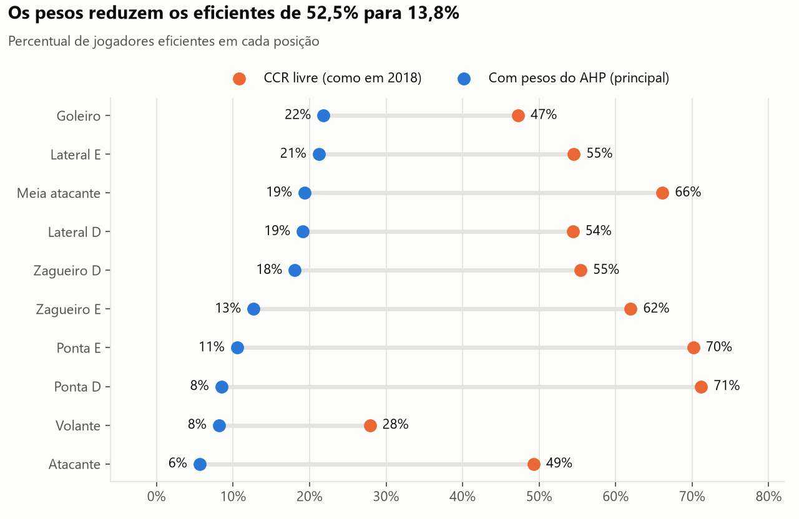

## Main results

Data collected on 22 November 2026, with the season still in progress.

- **13.8% of players are efficient** (102 of 739) in the main model. Without weight restrictions, as in 2018, it would be 52.5% (49% in the paper).
- **Clubs that earn more points have players with higher scores.** The correlation between a club's mean score and its points per match is 0.46 (0.64 in Série A and 0.35 in Série B). In 2018 the number of efficient players per club was unrelated to points (-0.06); here the correlation is 0.32.
- **Market value says little about efficiency** (r = 0.08), as in 2018.
- **Neither does age** (r = 0.06), as in 2018.

## Who is efficient, by position

A DEA score stops at 1. To show how far each efficient player goes beyond the others, the frontier is recalculated without that player: 1.60 means reaching 60% further than the frontier formed by the rest of the group. Each line also shows the deciding category, explained in the next section. Click a position to open its chart.

<details>
<summary><b>Striker</b>: 4 efficient, led by Martin Braithwaite (Grêmio), 1.60</summary>

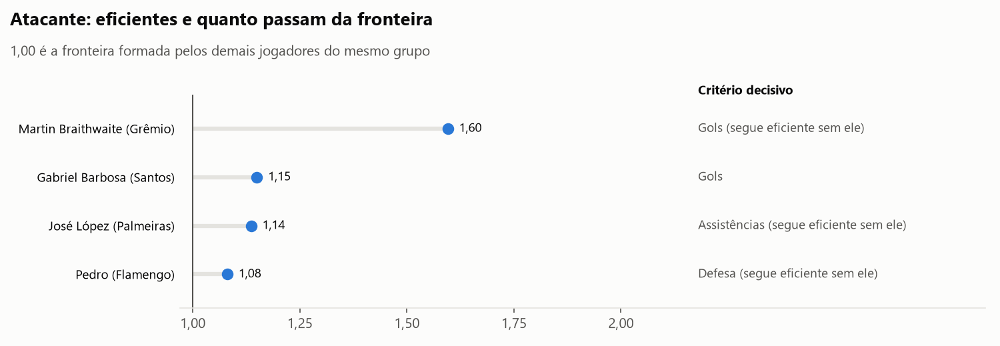

</details>

<details>
<summary><b>Winger</b>: 11 efficient, led by Adson (Vasco da Gama), 1.44</summary>

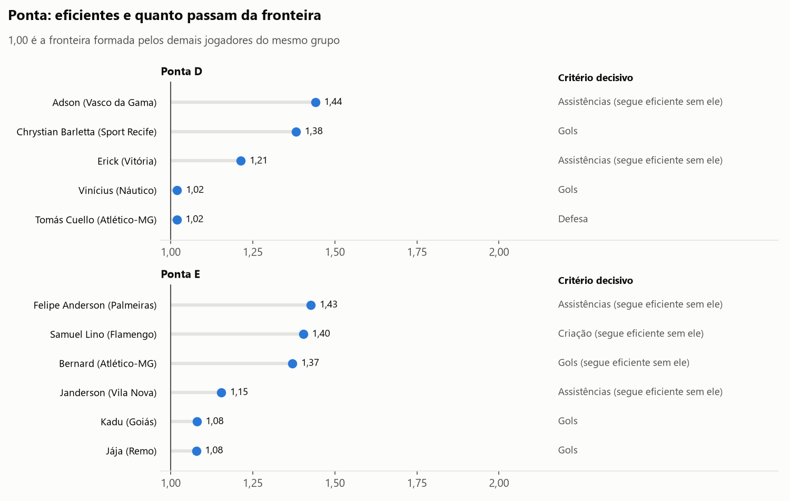

</details>

<details>
<summary><b>Attacking midfielder</b>: 12 efficient, led by Juninho (Novorizontino), 1.57</summary>

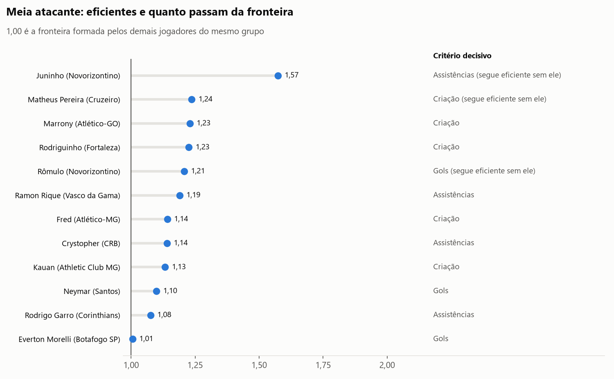

</details>

<details>
<summary><b>Defensive/central midfielder</b>: 12 efficient, led by Zé Vitor (Vitória), 1.45</summary>

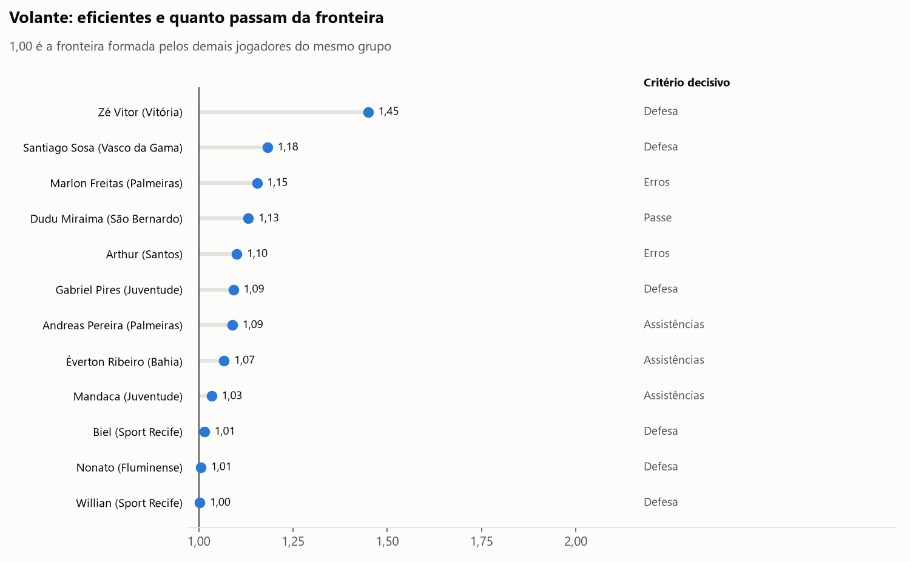

</details>

<details>
<summary><b>Full-back</b>: 27 efficient, led by José Rodríguez (Vasco da Gama), 1.41</summary>

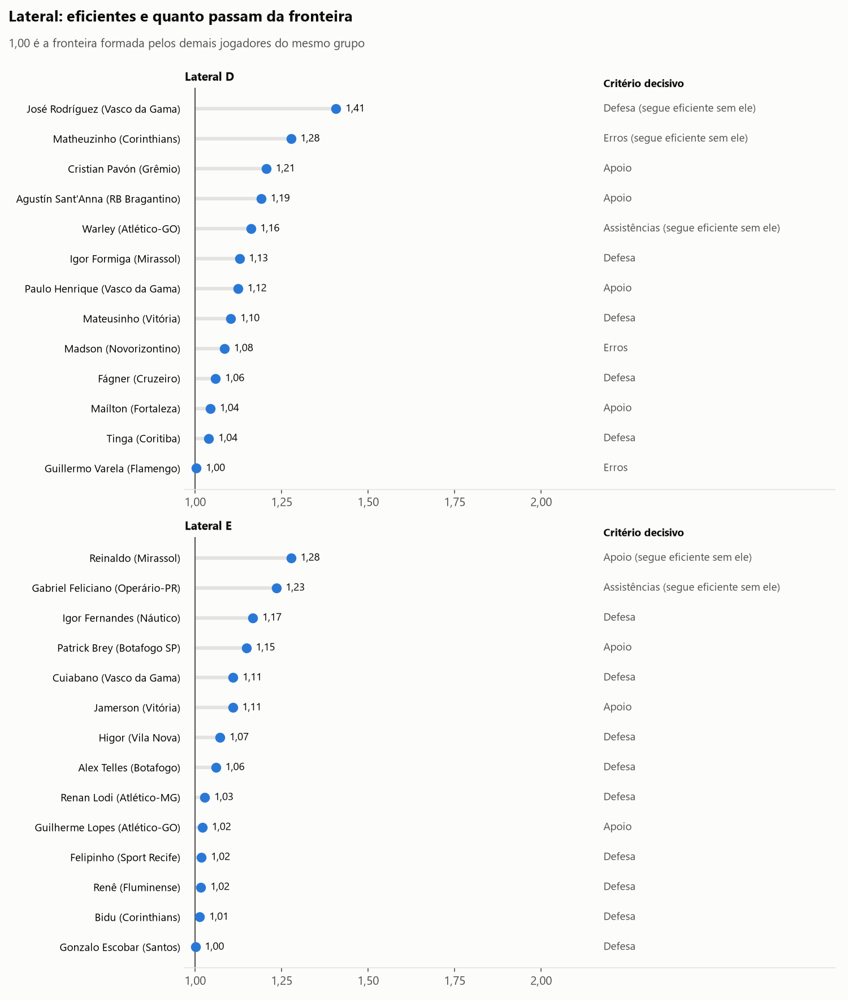

</details>

<details>
<summary><b>Centre-back</b>: 24 efficient, led by João Victor (Mirassol), 1.24</summary>

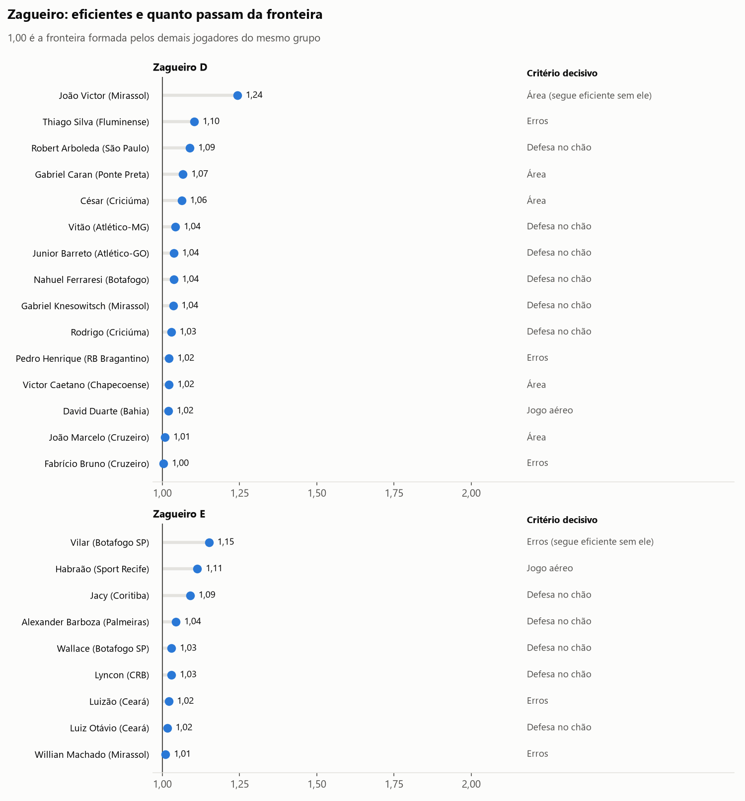

</details>

<details>
<summary><b>Goalkeeper</b>: 12 efficient, led by Pedro Morisco (Coritiba), 1.20</summary>

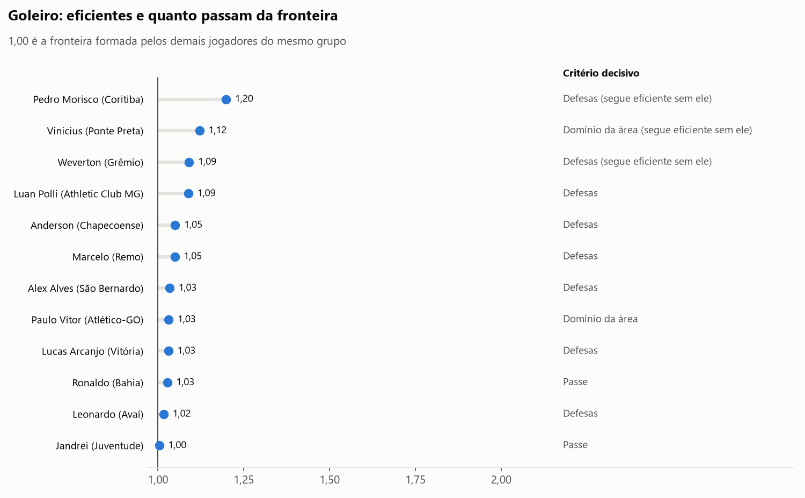

</details>

## What makes each one efficient

### Deciding category

The model is run again without one category at a time; the one whose removal lowers a player's score the most is the deciding one. 22 of the 102 efficient players stay efficient without any single category.

| Position | Efficient | Most frequent deciding category | Lose efficiency without it |
| --- | --- | --- | --- |
| Striker | 4 | goals (2) | 1 |
| Winger | 11 | goals (5) | 4 |
| Attacking midfielder | 12 | creation (5) | 5 |
| Defensive/central midfielder | 12 | defence (6) | 7 |
| Full-back | 27 | defence (14) | 16 |
| Centre-back | 24 | ground defending (11) | 16 |
| Goalkeeper | 12 | saves (8) | 6 |

### Decision trees

The trees are **not** the model. They summarise which statistics separate efficient players from the rest. “Describes” is the share of players the tree shown classifies correctly; “unseen” is measured leaving one player out at a time. Because efficient players are rare, answering “nobody is efficient” would already score high (last column), and on unseen players no tree beats that. Read them as a description of this sample, not as a prediction rule. The charts are in Portuguese.

| Position | Describes | Efficient captured | Unseen: accuracy | Unseen: efficient found | “Nobody” |
| --- | --- | --- | --- | --- | --- |
| Striker | 89% | 4 of 4 | 82% | 2 of 4 | 94% |
| Winger | 87% | 11 of 11 | 80% | 5 of 11 | 91% |
| Attacking midfielder | 85% | 12 of 12 | 69% | 9 of 12 | 81% |
| Defensive/central midfielder | 86% | 12 of 12 | 74% | 4 of 12 | 92% |
| Full-back | 90% | 24 of 27 | 69% | 10 of 27 | 80% |
| Centre-back | 83% | 24 of 24 | 74% | 16 of 24 | 84% |
| Goalkeeper | 85% | 12 of 12 | 78% | 8 of 12 | 78% |

<details>
<summary><b>Striker</b>: describes 89% of cases</summary>

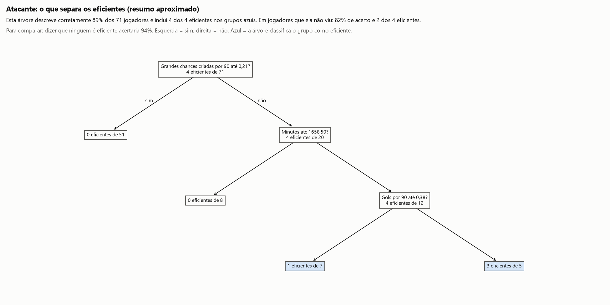

</details>

<details>
<summary><b>Winger</b>: describes 87% of cases</summary>

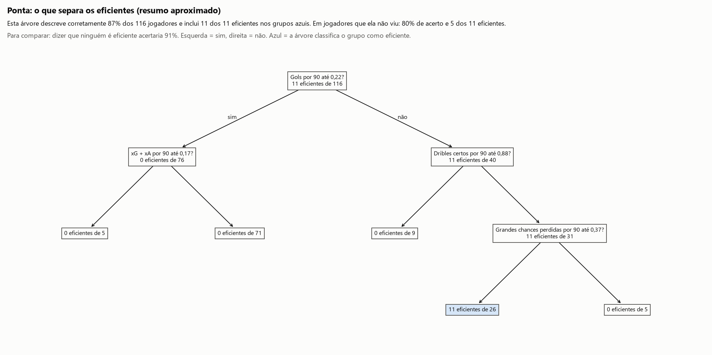

</details>

<details>
<summary><b>Attacking midfielder</b>: describes 85% of cases</summary>

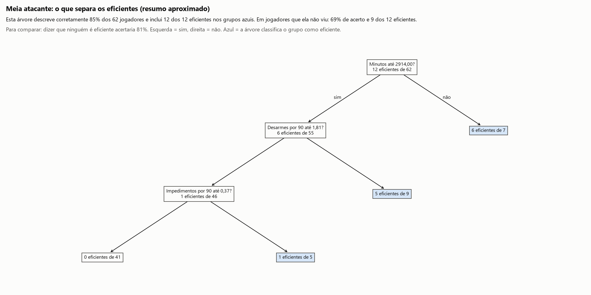

</details>

<details>
<summary><b>Defensive/central midfielder</b>: describes 86% of cases</summary>

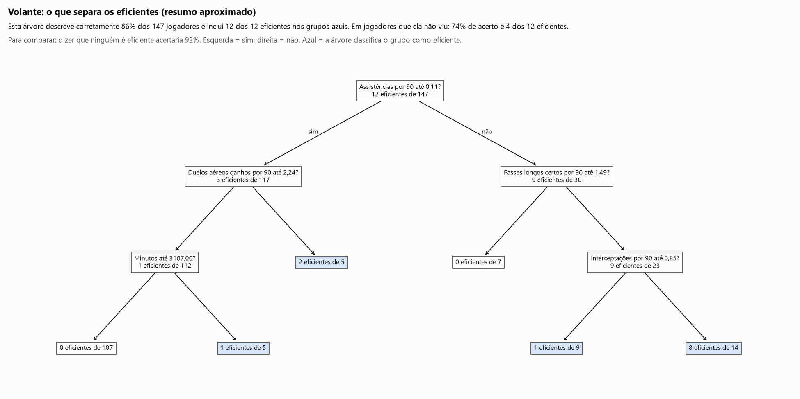

</details>

<details>
<summary><b>Full-back</b>: describes 90% of cases</summary>

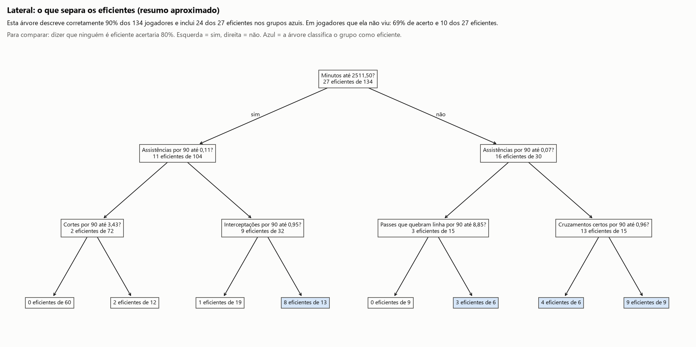

</details>

<details>
<summary><b>Centre-back</b>: describes 83% of cases</summary>

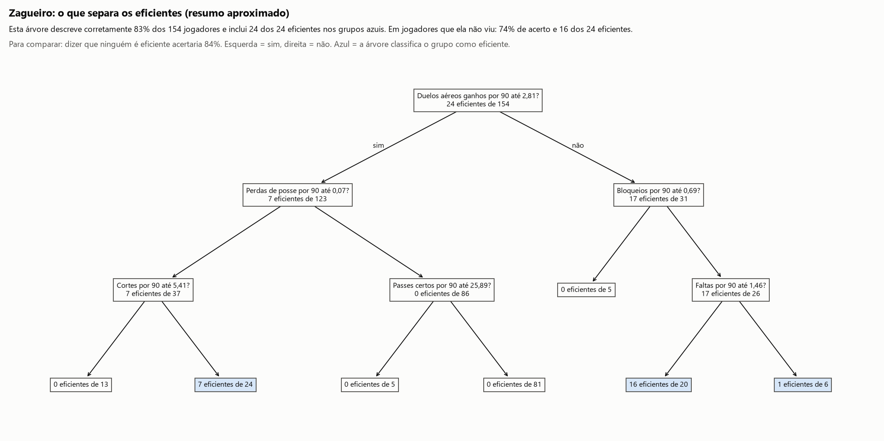

</details>

<details>
<summary><b>Goalkeeper</b>: describes 85% of cases</summary>

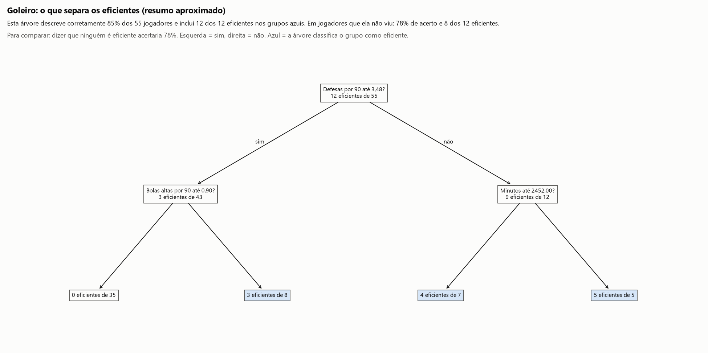

</details>

## Clubs

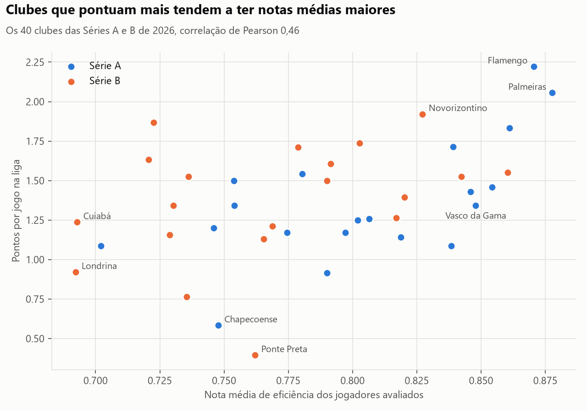

## Efficient and low-priced

Efficient players with a market value **below the median of their own group**, up to three per group, ordered by cross-efficiency. “Low-priced” is therefore relative: the same value can be cheap in one group and not in another, and some are far below the median while others are close to it. Market values are estimates published by the source.

| Position | Player (club) | Age | Market value (€ million) | Group median | % of median |
| --- | --- | --- | --- | --- | --- |
| Goalkeeper | Jandrei (Juventude) | 33 | 0.33 | 0.57 | 58% |
| Goalkeeper | Alex Alves (São Bernardo) | 40 | 0.15 | 0.57 | 26% |
| Goalkeeper | Paulo Vítor (Atlético-GO) | 37 | 0.27 | 0.57 | 48% |
| Right-back | Tinga (Coritiba) | 33 | 0.29 | 0.76 | 38% |
| Right-back | Warley (Atlético-GO) | 27 | 0.35 | 0.76 | 46% |
| Right-back | Fágner (Cruzeiro) | 37 | 0.37 | 0.76 | 48% |
| Left-back | Gabriel Feliciano (Operário-PR) | 25 | 0.52 | 0.80 | 65% |
| Left-back | Jamerson (Vitória) | 28 | 0.43 | 0.80 | 54% |
| Left-back | Reinaldo (Mirassol) | 37 | 0.56 | 0.80 | 71% |
| Right centre-back | César (Criciúma) | 33 | 0.19 | 0.58 | 34% |
| Right centre-back | Junior Barreto (Atlético-GO) | 28 | 0.35 | 0.58 | 60% |
| Right centre-back | Rodrigo (Criciúma) | 39 | 0.27 | 0.58 | 48% |
| Left centre-back | Lyncon (CRB) | 21 | 0.55 | 0.65 | 84% |
| Left centre-back | Luizão (Ceará) | 34 | 0.30 | 0.65 | 46% |
| Left centre-back | Wallace (Botafogo SP) | 32 | 0.21 | 0.65 | 32% |
| Defensive/central midfielder | Gabriel Pires (Juventude) | 33 | 0.21 | 0.90 | 24% |
| Defensive/central midfielder | Éverton Ribeiro (Bahia) | 37 | 0.67 | 0.90 | 75% |
| Defensive/central midfielder | Biel (Sport Recife) | 24 | 0.54 | 0.90 | 60% |
| Attacking midfielder | Crystopher (CRB) | 28 | 0.27 | 0.94 | 29% |
| Attacking midfielder | Marrony (Atlético-GO) | 27 | 0.33 | 0.94 | 35% |
| Attacking midfielder | Everton Morelli (Botafogo SP) | 29 | 0.91 | 0.94 | 96% |
| Right winger | Vinícius (Náutico) | 33 | 0.20 | 1.74 | 12% |
| Left winger | Bernard (Atlético-MG) | 34 | 0.66 | 0.77 | 86% |
| Striker | Martin Braithwaite (Grêmio) | 35 | 0.78 | 1.01 | 77% |

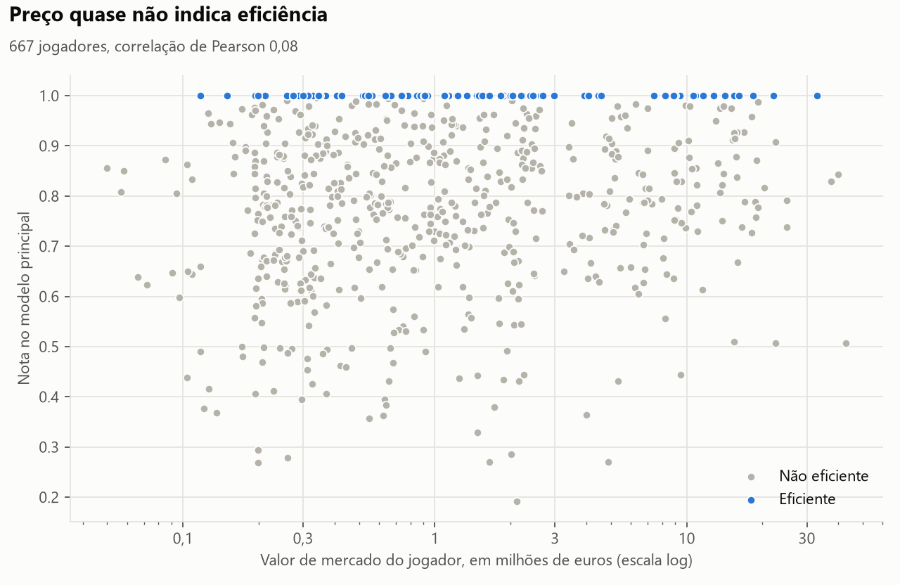

72 of the 739 players have no market value at the source and are left out of this chart and the list.

## DEA against a single measure

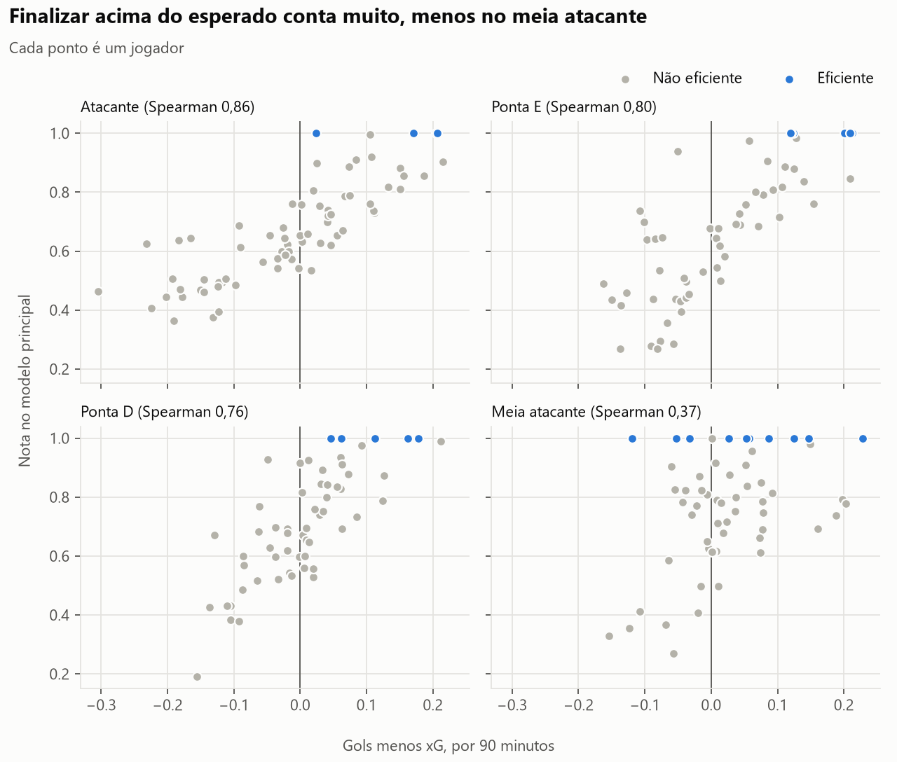

For strikers and wingers the score closely follows goals minus xG (Spearman from 0.76 to 0.86). This is largely a consequence of the design: goals weigh more than 60% and xG is an input. For attacking midfielders, where assists weigh as much as goals, the correlation drops to 0.37.

## Data

Match-level statistics from [FotMob](https://www.fotmob.com/) for five 2026 competitions: Série A, Série B, Copa do Brasil, Copa Libertadores and Copa Sudamericana. Only players from the 40 Série A and B clubs are included.

- **Sample:** as in the paper, the half with the most minutes (899 or more). That is 739 of 1,477 players.
- **Ten groups:** goalkeeper, centre-back, full-back, defensive/central midfielder, attacking midfielder, winger and striker, with centre-backs, full-backs and wingers split into right and left. A centre-back's side comes from the lineup positions; in case of a tie, from the preferred foot.
- **The data are not in the repository.** [FotMob's terms of use](https://www.fotmob.com/tos.txt) forbid automated collection and redistribution without written consent, so neither the data nor the collection scripts are published.

32 matches (31 from Copa do Brasil and 1 from Libertadores) have no player statistics at the source.

## Model

**Inputs (less is better):** minutes played and the market value of the club's squad, on a log scale. Strikers, wingers and attacking midfielders have a third one: xG + xA, the quality of their chances to score and to assist.

**Outputs (more is better):** chosen by position, as season totals. Within each position, variables highly correlated with others (|r| ≥ 0.60) were removed, always keeping goals, assists and big chances created. Negative actions (fouls, possession lost, times dribbled past and so on) form a single error index. The lists are in [criterios.py](criterios.py) and the removals in [cortes.json](cortes.json).

**Weights.** In classic DEA each player picks the weights that favour them most, so being the best in one variable is enough to look efficient. The main model is therefore a CCR model with virtual weight restrictions ([Wong and Beasley, 1990](https://doi.org/10.1057/jors.1990.120)): each category accounts for a fixed share of the score, and the model chooses how to split it inside the category. The shares come from an AHP with incomplete pairwise comparisons ([Harker, 1987](https://doi.org/10.1016/0270-0255(87)90503-3)), which I answered:

| Position | Category weights |
| --- | --- |
| Striker | goals 64%, assists 13%, creation 9%, defence 7%, errors 7% |
| Winger | goals 60%, assists 12%, creation 12%, defence 9%, errors 7% |
| Attacking midfielder | goals 36%, assists 36%, creation 18%, defence 7%, errors 4% |
| Defensive/central midfielder | defence 35%, errors 35%, passing 18%, assists 12% |
| Full-back | defence 30%, attacking support 30%, errors 30%, assists 10% |
| Centre-back | ground defending 24%, box defending 24%, aerial duels 24%, errors 24%, build-up 6% |
| Goalkeeper | saves 82%, command of the area 9%, passing 9% |

These are my own judgements, from a single respondent, and since each position uses one answer per category there is no consistency test. I saw the first results before settling the weights and changed two things afterwards: the weight of assists for defensive midfielders and full-backs, and moving the midfielders' aerial duels into defence.

**Method comparison:** unrestricted CCR, BCC, super-efficiency ([Andersen and Petersen, 1993](https://doi.org/10.1287/mnsc.39.10.1261)), cross-efficiency and TOPSIS. Mean Spearman correlation between rankings:

| | main | CCR | BCC | super | cross | TOPSIS |
| --- | --- | --- | --- | --- | --- | --- |
| main | 1 | 0.61 | 0.39 | 0.70 | 0.72 | 0.59 |
| CCR | | 1 | 0.61 | 0.86 | 0.68 | 0.58 |
| BCC | | | 1 | 0.57 | 0.45 | 0.41 |
| super-efficiency | | | | 1 | 0.77 | 0.68 |
| cross-efficiency | | | | | 1 | 0.69 |
| TOPSIS | | | | | | 1 |

## How much the choices change the result

Share of efficient players:

| Club value as input | Exact weights | At least half of each weight | Unrestricted CCR | Série A / B (exact weights) |
| --- | --- | --- | --- | --- |
| **Log (main)** | **13.8%** | 37.9% | 52.5% | 15% / 12% |
| Raw value | 15.7% | 43.8% | 56.0% | 11% / 21% |
| No club value | 7.2% | 27.2% | 41.7% | 9% / 6% |

The comparison between divisions flips with this choice. With the raw value, which ranges from 3 to 225 million euros, the model expects very little from the cheaper clubs and favours Série B.

## Minutes cut-off

The paper keeps the half with the most minutes. Running the main model again with other minimums:

| Minimum minutes | 600 | **899 (main)** | 1,200 | 1,500 |
| --- | --- | --- | --- | --- |
| Players | 892 | **739** | 599 | 485 |
| Efficient | 13.1% | **13.8%** | 15.5% | 18.4% |
| Série A / B efficient | 15% / 11% | **15% / 12%** | 18% / 13% | 21% / 15% |
| Club score vs. points per match | 0.56 | **0.46** | 0.46 | 0.45 |
| Market value vs. score | 0.10 | **0.08** | 0.05 | 0.04 |
| Age vs. score | 0.03 | **0.06** | 0.06 | 0.10 |
| Player order (Spearman with main) | 0.99 | **1** | 0.99 | 0.98 |
| Main-model efficient players kept | 101 of 102 | **—** | 87 of 89 | 79 of 82 |

The conclusions hold. The share of efficient players rises with higher cut-offs because the groups get smaller (the smallest goes from 55 to 31 players at 1,500 minutes). In the shortlist below, only Jandrei and Wallace stop being efficient, from 1,200 minutes on. At these higher cut-offs the winger groups fall below the usual minimum size for DEA (three players per variable): the left side at 1,200 minutes and both sides at 1,500.

## Limitations

- **Efficient does not mean best.** The score compares output with minutes, club and, in attack, chance quality, only among players in the same group.
- **Mixed competitions.** Goals in Série B or in early cup rounds count the same as goals in Série A.
- **Extreme values matter.** A player far above everyone else in one variable becomes the benchmark for almost the whole group.
- **Groups of different sizes** (55 to 147) do not have directly comparable percentages.

## How to run

```bash
pip install -r requirements.txt
```

The scripts run from this folder and expect a dataset in `../../dados-fotmob`, which is not distributed. Without it, the code serves as documentation of the method.

| Script | What it does |
| --- | --- |
| `01_base_analise.py` | One row per player, with position, side and aggregated statistics |
| `02_correlacao.py` | Removes redundant variables by position |
| `03_rodar_dea.py` | The six methods; accepts the `log`, `valor` (raw) and `sem` (no club value) variants |
| `04_analises.py` | Methods, xG, hypotheses, clubs and shortlist |
| `05_graficos.py` | Charts in this README |
| `06_sensibilidade_minutos.py` | Runs the model again with other minute cut-offs |
| `07_explicacao.py` | Distance beyond the frontier, deciding category and decision trees |

The models are in [dea.py](dea.py) and the weights in [ahp.py](ahp.py) and [ahp_respostas.json](ahp_respostas.json).
