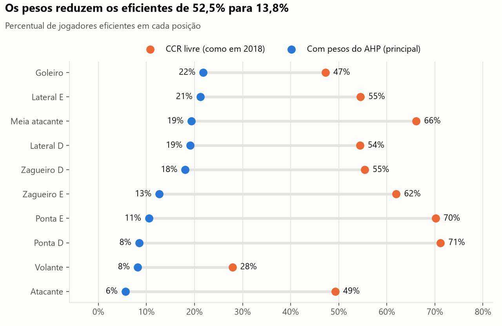
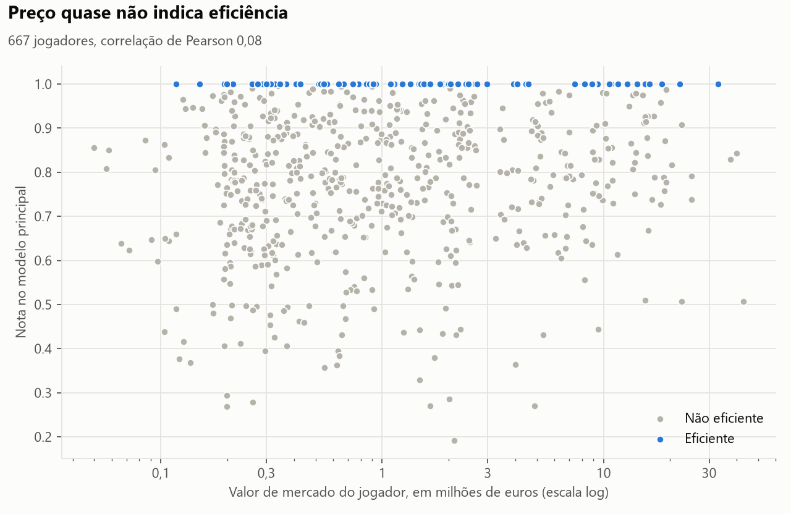

# Eficiência de jogadores no Brasileirão 2026 (DEA)

*Leia em: [English](README.en.md)*

Quem entrega mais do que os minutos em campo e o tamanho do clube fariam esperar? Este projeto mede a eficiência de jogadores das Séries A e B de 2026, por posição, com Análise Envoltória de Dados (DEA).

Ele revisita um artigo meu de 2018, que aplicou DEA a sete campeonatos europeus ([Salles et al., 2018](https://doi.org/10.4322/PODes.2018.002)), com dados brasileiros, mais métodos e pesos que refletem a função de cada posição.



## Principais resultados

Dados coletados em 22/11/2026, com a temporada ainda em andamento.

- **13,8% dos jogadores são eficientes** (102 de 739) no modelo principal. Sem restrição de pesos, como em 2018, seriam 52,5% (no artigo, 49%).
- **Clubes que pontuam mais têm jogadores com notas maiores.** A correlação entre a nota média do clube e os pontos por jogo é de 0,46 (0,64 na Série A e 0,35 na B). Em 2018, o número de eficientes por clube não tinha relação com a pontuação (-0,06); aqui a relação é de 0,32.
- **Valor de mercado quase não indica eficiência** (r = 0,08), como em 2018.
- **Idade também não** (r = 0,06), como em 2018.


## Dados

Estatísticas do [FotMob](https://www.fotmob.com/), por partida, de cinco competições de 2026: Série A, Série B, Copa do Brasil, Libertadores e Sul-Americana. Entram só jogadores dos 40 clubes das Séries A e B.

- **Amostra:** como no artigo, a metade com mais minutos (a partir de 899). São 739 de 1.477 jogadores.
- **Dez grupos:** goleiro, zagueiro, lateral, volante, meia atacante, ponta e atacante, com zagueiro, lateral e ponta separados em direita e esquerda. O lado do zagueiro vem da posição nas escalações; em caso de empate, do pé preferido.
- **Os dados não estão no repositório.** Os [termos de uso do FotMob](https://www.fotmob.com/tos.txt) vedam coleta automatizada e redistribuição sem consentimento escrito, por isso nem os dados nem os scripts de coleta são publicados.

32 partidas (31 da Copa do Brasil e 1 da Libertadores) não têm estatísticas por jogador na fonte.

## Modelo

**Entradas (menos é melhor):** minutos jogados e valor de mercado do elenco do clube, em logaritmo. Atacantes, pontas e meias atacantes têm uma terceira: xG + xA, a qualidade das chances de finalizar e de dar assistência.

**Saídas (mais é melhor):** escolhidas por posição, em totais da temporada. Em cada posição, saíram as variáveis muito correlacionadas com outras (|r| ≥ 0,60), preservando gols, assistências e grandes chances criadas. As ações negativas (faltas, perdas de posse, dribles sofridos etc.) formam um único índice de erros. As listas estão em [criterios.py](criterios.py) e os cortes em [cortes.json](cortes.json).

**Pesos.** No DEA clássico, cada jogador escolhe os pesos que mais o favorecem, e basta ser o melhor em uma variável para parecer eficiente. Por isso o modelo principal é um CCR com restrição de pesos virtuais ([Wong e Beasley, 1990](https://doi.org/10.1057/jors.1990.120)): cada categoria responde por uma fatia fixa da nota, e o modelo escolhe como dividir dentro dela. As fatias vêm de um AHP com comparações incompletas ([Harker, 1987](https://doi.org/10.1016/0270-0255(87)90503-3)), respondido por mim:

| Posição | Pesos das categorias |
| --- | --- |
| Atacante | gols 64%, assistências 13%, criação 9%, defesa 7%, erros 7% |
| Ponta | gols 60%, assistências 12%, criação 12%, defesa 9%, erros 7% |
| Meia atacante | gols 36%, assistências 36%, criação 18%, defesa 7%, erros 4% |
| Volante | defesa 35%, erros 35%, passe 18%, assistências 12% |
| Lateral | defesa 30%, apoio 30%, erros 30%, assistências 10% |
| Zagueiro | defesa no chão 24%, área 24%, jogo aéreo 24%, erros 24%, saída de bola 6% |
| Goleiro | defesas 82%, domínio da área 9%, passe 9% |

São os meus julgamentos, de um único respondente, e como cada posição usa uma resposta por categoria não há teste de consistência. Vi os primeiros resultados antes de fechar os pesos e ajustei dois pontos depois: o peso das assistências em volante e lateral e a inclusão do jogo aéreo do volante dentro da defesa.

**Comparação de métodos:** CCR livre, BCC, supereficiência ([Andersen e Petersen, 1993](https://doi.org/10.1287/mnsc.39.10.1261)), eficiência cruzada e TOPSIS. Correlação de Spearman média entre os rankings:

| | principal | CCR | BCC | super | cruzada | TOPSIS |
| --- | --- | --- | --- | --- | --- | --- |
| principal | 1 | 0,61 | 0,39 | 0,70 | 0,72 | 0,59 |
| CCR | | 1 | 0,61 | 0,86 | 0,68 | 0,58 |
| BCC | | | 1 | 0,57 | 0,45 | 0,41 |
| supereficiência | | | | 1 | 0,77 | 0,68 |
| cruzada | | | | | 1 | 0,69 |
| TOPSIS | | | | | | 1 |

## Quanto as escolhas mudam o resultado

Percentual de eficientes:

| Valor do clube como entrada | Pesos exatos | Pelo menos metade do peso | CCR livre | Série A / B (pesos exatos) |
| --- | --- | --- | --- | --- |
| **Logaritmo (principal)** | **13,8%** | 37,9% | 52,5% | 15% / 12% |
| Valor bruto | 15,7% | 43,8% | 56,0% | 11% / 21% |
| Sem o valor do clube | 7,2% | 27,2% | 41,7% | 9% / 6% |

A comparação entre as divisões se inverte conforme essa escolha. Com o valor bruto, que vai de 3 a 225 milhões de euros, o modelo espera muito pouco dos clubes baratos e favorece a Série B.

## Corte de minutos

O artigo usa a metade com mais minutos. Repetindo o modelo principal com outros mínimos:

| Mínimo de minutos | 600 | **899 (principal)** | 1.200 | 1.500 |
| --- | --- | --- | --- | --- |
| Jogadores | 892 | **739** | 599 | 485 |
| Eficientes | 13,1% | **13,8%** | 15,5% | 18,4% |
| Série A / B eficientes | 15% / 11% | **15% / 12%** | 18% / 13% | 21% / 15% |
| Nota do clube x pontos por jogo | 0,56 | **0,46** | 0,46 | 0,45 |
| Valor de mercado x nota | 0,10 | **0,08** | 0,05 | 0,04 |
| Idade x nota | 0,03 | **0,06** | 0,06 | 0,10 |
| Ordem dos jogadores (Spearman com o principal) | 0,99 | **1** | 0,99 | 0,98 |
| Eficientes do principal que continuam | 101 de 102 | **—** | 87 de 89 | 79 de 82 |

As conclusões se mantêm. O percentual de eficientes sobe com cortes mais altos porque os grupos ficam menores (o menor passa de 55 para 31 jogadores em 1.500 minutos). Da lista de oportunidades, só Jandrei e Wallace deixam de ser eficientes, a partir de 1.200 minutos. Com esses cortes mais altos, os pontas ficam abaixo do tamanho mínimo usual para o DEA (três jogadores por variável): a ponta esquerda em 1.200 minutos e as duas em 1.500.

## DEA contra uma medida só


Em atacantes e pontas, a nota acompanha de perto o saldo de gols menos xG (Spearman de 0,76 a 0,86). Isso é, em boa parte, consequência do desenho: gols pesam mais de 60% e o xG é uma entrada. No meia atacante, em que assistências pesam tanto quanto gols, a relação cai para 0,37.

## Eficientes e baratos

Jogadores eficientes com valor de mercado abaixo da mediana do grupo, até três por posição, em ordem de eficiência cruzada:

| Posição | Jogadores (clube) |
| --- | --- |
| Goleiro | Jandrei (Juventude), Alex Alves (São Bernardo), Paulo Vítor (Atlético-GO) |
| Lateral direito | Tinga (Coritiba), Warley (Atlético-GO), Fágner (Cruzeiro) |
| Lateral esquerdo | Gabriel Feliciano (Operário-PR), Jamerson (Vitória), Reinaldo (Mirassol) |
| Zagueiro direito | César (Criciúma), Junior Barreto (Atlético-GO), Rodrigo (Criciúma) |
| Zagueiro esquerdo | Lyncon (CRB), Luizão (Ceará), Wallace (Botafogo-SP) |
| Volante | Gabriel Pires (Juventude), Éverton Ribeiro (Bahia), Biel (Sport) |
| Meia atacante | Crystopher (CRB), Marrony (Atlético-GO), Everton Morelli (Botafogo-SP) |
| Ponta direita | Vinícius (Náutico) |
| Ponta esquerda | Bernard (Atlético-MG) |
| Atacante | Martin Braithwaite (Grêmio) |



72 dos 739 jogadores não têm valor de mercado na fonte e ficam fora desse gráfico e da lista.

## Limitações

- **Eficiente não é o mesmo que melhor.** A nota compara a produção com minutos, clube e, no ataque, qualidade das chances, só entre jogadores do mesmo grupo.
- **Competições misturadas.** Gols na Série B ou nas fases iniciais das copas contam como os da Série A.
- **Valores extremos pesam.** Um jogador muito acima dos demais em uma variável vira referência de quase todo o grupo.
- **Grupos de tamanhos diferentes** (55 a 147) não têm percentuais diretamente comparáveis.

## Como rodar

```bash
pip install -r requirements.txt
```

Os scripts rodam nesta pasta e esperam uma base em `../../dados-fotmob`, que não é distribuída. Sem ela, o código serve como documentação do método.

| Script | O que faz |
| --- | --- |
| `01_base_analise.py` | Uma linha por jogador, com posição, lado e estatísticas somadas |
| `02_correlacao.py` | Cortes de variáveis redundantes por posição |
| `03_rodar_dea.py` | Os seis métodos; aceita as variantes `log`, `valor` e `sem` |
| `04_analises.py` | Métodos, xG, hipóteses, clubes e oportunidades |
| `05_graficos.py` | Gráficos deste README |
| `06_sensibilidade_minutos.py` | Repete o modelo com outros cortes de minutos |

Os modelos estão em [dea.py](dea.py) e os pesos em [ahp.py](ahp.py) e [ahp_respostas.json](ahp_respostas.json).
