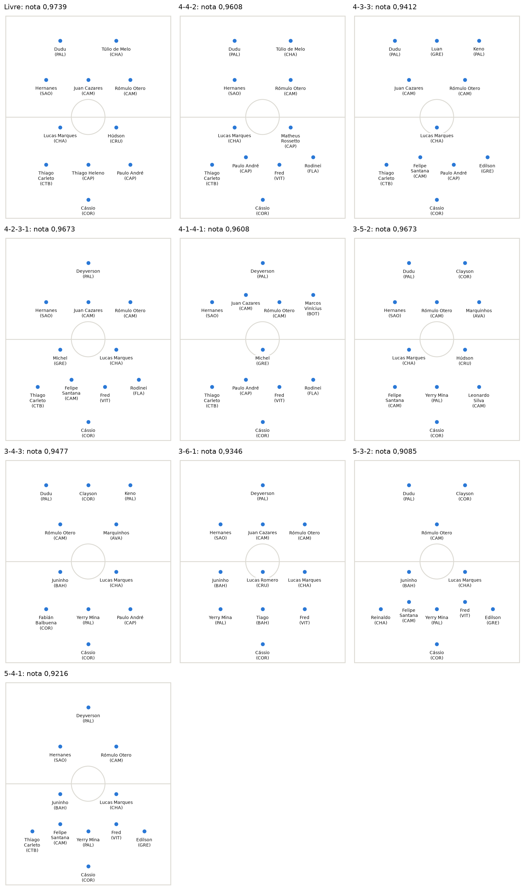

# football-analytics

*Read in: [Português](README.md)*

Football analysis projects using data from the 2017 Brazilian Championship. Both use the Multiple Choice Method, from the [mem-ga](../mem-ga/README.en.md) package in the sibling folder, to find players who complement each other, instead of adding up the strongest ones.



| Project | What it does | How to run |
| --- | --- | --- |
| [Lineup (MEM-GA)](escalacao/README.en.md) | Builds the 10-outfield-player team that complements itself best in a formation, such as 4-4-2, with a genetic algorithm | `python -m escalacao` |
| [Signings (GA-MEM)](contratacoes/README.en.md) | Starts from a club's current team and lists the signings that most improve its complementarity | `python -m contratacoes` |

The [full analysis](escalacao/analise.ipynb), in Portuguese, shows the team for each formation and why the most complementary team is not the 10 strongest players.

The code is in English; folder names, messages, comments and the programs' output are in Portuguese.

## Installation

In the `football-analytics` folder:

```bash
pip install -r requirements.txt
```

This installs `mem-ga` from the sibling folder, in editable mode, along with NumPy, Matplotlib and pytest.

## How to run

Both programs run from the `football-analytics` folder and ask for what is missing: the formation, for the lineup, and the club and position, for signings. To skip the questions:

```bash
python -m escalacao --formation 4-4-2 --seed 2017
python -m contratacoes --club VAS --position ata --options 3
```

Each program lists its options with `--help`. To run the tests:

```bash
python -m pytest
```

## Layout

```text
football-analytics/
├── comum/                  shared code: data loading, team score, goalkeepers, pitch in the terminal
├── escalacao/              MEM-GA: build the team
├── contratacoes/           GA-MEM: suggest signings
├── dados/
│   └── brasileirao-2017/   WhoScored statistics and the file format
└── tests/
```

A new project goes in a folder next to `escalacao/` and `contratacoes/`, using what is in `comum/`, and gets a row in the table above. A new dataset goes in `dados/<source>/`, with the same files and a `FONTE.md` saying where it came from, and the programs use it with `--data dados/<source>`.

## Data

Player statistics were collected by hand from [WhoScored](https://www.whoscored.com/) in 2017, with the site's permission for use in the research. [FONTE.en.md](dados/brasileirao-2017/FONTE.en.md) describes the files and columns.

## Source

The projects come from my master's dissertation *MEM-GA: Método de Escolha Múltipla com Algoritmo Genético aplicado à formação de equipes de futebol* (Sérgio Augusto Faria Salles, Instituto Federal Fluminense, 2018). The MEM was proposed in the doctoral thesis of Henrique Rego Monteiro da Hora (Universidade Federal Fluminense, 2013).
