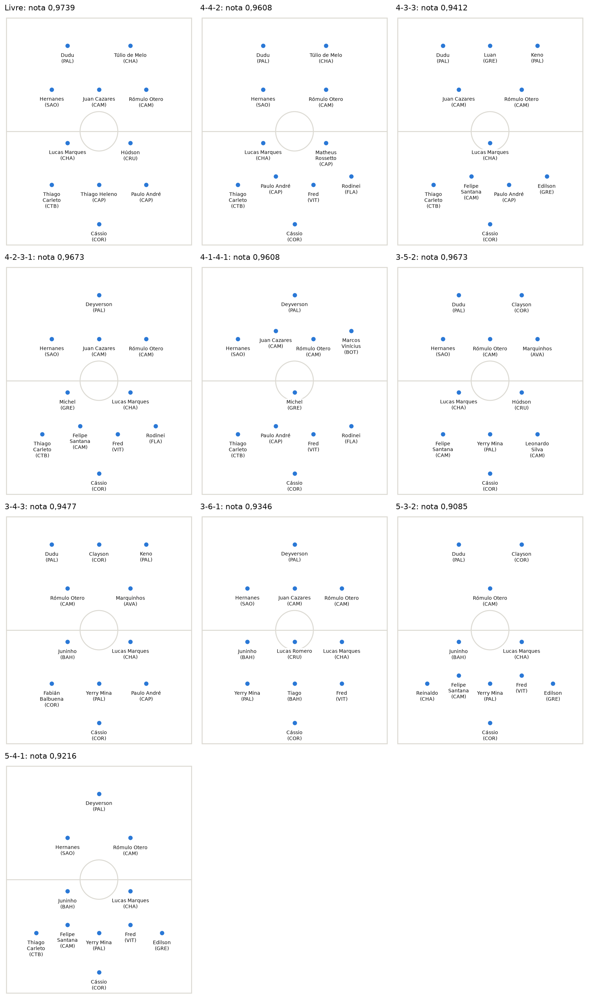

# football-analytics

*Leia em: [English](README.en.md)*

Projetos de análise de futebol com dados do Campeonato Brasileiro de 2017. Os dois usam o Método de Escolha Múltipla, do pacote [mem-ga](../mem-ga/README.md), na pasta vizinha, para achar jogadores que se completam, em vez de somar os mais fortes.



| Projeto | O que faz | Como rodar |
| --- | --- | --- |
| [Escalação (MEM-GA)](escalacao/README.md) | Monta o time de 10 jogadores de linha que mais se completa numa formação, como 4-4-2, com um algoritmo genético | `python -m escalacao` |
| [Contratações (GA-MEM)](contratacoes/README.md) | Parte do time atual de um clube e lista as contratações que mais melhoram a complementação dele | `python -m contratacoes` |

A [análise completa](escalacao/analise.ipynb) mostra os times de cada formação e por que o time mais complementar não é o dos 10 jogadores mais fortes.

## Instalação

Na pasta `football-analytics`:

```bash
pip install -r requirements.txt
```

Isso instala o `mem-ga` da pasta vizinha, em modo editável, junto com NumPy, Matplotlib e pytest.

## Como rodar

Os dois programas rodam a partir da pasta `football-analytics` e perguntam o que falta: a formação, no caso da escalação, e o clube e a posição, no caso das contratações. Para pular as perguntas:

```bash
python -m escalacao --formation 4-4-2 --seed 2017
python -m contratacoes --club VAS --position ata --options 3
```

As opções de cada um aparecem com `--help`. Para rodar os testes:

```bash
python -m pytest
```

## Organização

```text
football-analytics/
├── comum/                  leitura dos dados, nota do time, goleiros, campo no terminal
├── escalacao/              MEM-GA: montar o time
├── contratacoes/           GA-MEM: sugerir contratações
├── dados/
│   └── brasileirao-2017/   estatísticas do WhoScored e o formato dos arquivos
└── tests/
```

Um projeto novo entra como uma pasta ao lado de `escalacao/` e `contratacoes/`, usando o que estiver em `comum/`, e ganha uma linha na tabela acima. Uma base de dados nova entra em `dados/<fonte>/`, com os mesmos arquivos e um `FONTE.md` dizendo de onde veio, e os programas a usam com `--data dados/<fonte>`.

## Dados

As estatísticas dos jogadores foram coletadas manualmente do [WhoScored](https://www.whoscored.com/) em 2017, com autorização do site para uso na pesquisa. O [FONTE.md](dados/brasileirao-2017/FONTE.md) descreve os arquivos e as colunas.

## Fonte

Os projetos partem da minha dissertação *MEM-GA: Método de Escolha Múltipla com Algoritmo Genético aplicado à formação de equipes de futebol* (Sérgio Augusto Faria Salles, Instituto Federal Fluminense, 2018). O MEM foi proposto na tese de Henrique Rego Monteiro da Hora (Universidade Federal Fluminense, 2013).

O método aplicado ao futebol está descrito no artigo: Salles, S. A. F., da Hora, H. R. M., Erthal Júnior, M., Velasco, A. S. e Croce, P. R. (2022). Multiple Choice Method with Genetic Algorithm for the Formation of Soccer Teams. *Pesquisa Operacional*, 42, e243537. <https://doi.org/10.1590/0101-7438.2022.042.00243537>
