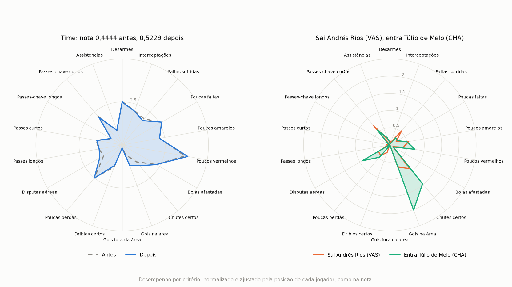

# Signings (GA-MEM)

*Read in: [Português](README.md)*

GA-MEM works the other way around from the [lineup](../escalacao/README.en.md): instead of building a team from scratch, it starts from a club and suggests the signings that most improve its complementarity. The score is the same, explained [in the lineup README](../escalacao/README.en.md#the-method).

Part of [football-analytics](../README.en.md). Install the dependencies as in the [football-analytics README](../README.en.md#installation) and run from the `football-analytics` folder:

```bash
python -m contratacoes
```

The program shows the list of clubs and asks three questions, in Portuguese:

1. **Club:** it accepts the list number, the name, or the code.
2. **Option:** choose the signing's position or let the method suggest any position.
3. **Amount:** how many options to show. Pressing Enter shows 5.

The result shows the score before and after the best option, the lineup with it, and the list of options, with the gain of each one. Each option is a single signing, not a package. If no option improves the team, the program says so, keeps the current team on the pitch, and lists the ones that hurt it least. Across the 20 clubs and 6 positions, this only happens with Vasco's right back. To skip the questions, use `--club`, `--position`, and `--options`.

**How the method decides:**

- The current team is the club's 10 outfield players with the most minutes, with at least one in each position. If the club has fewer than 10 outfield players with the minimum minutes, the program warns how many players the score used, and it is not comparable with the score of a 10-player team.
- Candidates are players from other clubs with at least 850 minutes.
- Swaps are always position by position: a forward only replaces a forward. Among the starters in that position, the one whose exit most improves the score leaves.
- The method tests every candidate, so the list is exact. With one signing at a time there are few cases, and the genetic algorithm is not needed here.
- The default tau is 0.24, the same as in the lineup.
- The goalkeeper shown is the one who played most for the club. They do not count toward the score.

Examples of the best option from any position:

| Club | Current score | With the signing | Leaves | Arrives |
| --- | --- | --- | --- | --- |
| Grêmio | 0.5686 | 0.6667 | Ramiro | Agustín Allione (BAH) |
| Santos | 0.6078 | 0.7582 | Ricardo Oliveira | Dudu (PAL) |
| Corinthians | 0.5163 | 0.6667 | Rodriguinho | Agustín Allione (BAH) |
| Vasco | 0.4444 | 0.5229 | Andrés Ríos | Túlio de Melo (CHA) |

The radar chart shows Vasco's signing. On the right, Túlio de Melo is much stronger than Andrés Ríos in goals inside the box and shots on target, and also in aerial duels, but falls behind in fouls suffered and dribbles. On the left, the team's average barely changes, because he is one player out of 10, but the gain falls on criteria where the team was weak, and that is enough to raise the score from 0.4444 to 0.5229.



At the end, the radar chart of the best option opens in a separate window. To save it, use `--radar` with the file name, as in `python -m contratacoes --club VAS --position ata --options 3 --radar radar.png`, and to skip the window, use `--no-plot`.

The best option changes from club to club, because a player's value depends on what the team already has. Across the 20 clubs, 14 different names appear, and the most repeated is Agustín Allione, at 3 clubs. The method ignores price and availability, so it is worth checking the other options on the list.

## Sources

The data and the score are the same as the lineup's. See the [sources](../escalacao/README.en.md#sources) and the data's [FONTE.en.md](../dados/brasileirao-2017/FONTE.en.md).
