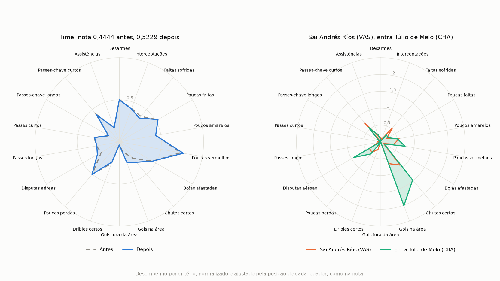

# Contratações (GA-MEM)

*Leia em: [English](README.en.md)*

O GA-MEM funciona ao contrário da [escalação](../escalacao/README.md): em vez de montar um time do zero, parte de um clube e sugere as contratações que mais melhoram a complementação dele. A nota é a mesma, explicada [no README da escalação](../escalacao/README.md#o-método).

Faz parte do [football-analytics](../README.md). Instale as dependências como no [README do football-analytics](../README.md#instalação) e rode a partir da pasta `football-analytics`:

```bash
python -m contratacoes
```

O programa mostra a lista de clubes e faz três perguntas:

1. **Clube:** aceita o número da lista, o nome ou a sigla.
2. **Opção:** escolher a posição da contratação ou deixar o método sugerir de qualquer posição.
3. **Quantidade:** quantas opções mostrar. O Enter mostra 5.

O resultado mostra a nota antes e depois da melhor opção, o time em campo com ela e a lista de opções, com o ganho de cada uma. Cada opção é uma contratação só, e não um pacote. Se nenhuma opção melhora o time, o programa avisa, mantém o time atual em campo e lista as que menos pioram. Nos 20 clubes e 6 posições, isso só acontece com o lateral direito do Vasco. Para pular as perguntas, use `--club`, `--position` e `--options`.

**Como o método decide:**

- O time atual são os 10 jogadores de linha com mais minutos no clube, com pelo menos um em cada posição. Se o clube tiver menos de 10 jogadores de linha com os minutos mínimos, o programa avisa com quantos a nota foi calculada, e ela não é comparável com a de times de 10.
- Os candidatos são os jogadores de outros clubes com pelo menos 850 minutos.
- A troca é sempre posição por posição: um atacante só entra no lugar de um atacante. Entre os titulares da posição, sai aquele cuja saída mais melhora a nota.
- O método testa todos os candidatos, então a lista é exata. Com uma contratação por vez são poucos casos, e o algoritmo genético não é necessário aqui.
- O tau padrão é 0,24, o mesmo da escalação.
- O goleiro mostrado é o que mais jogou no clube. Ele não entra na nota.

Exemplos da melhor opção de qualquer posição:

| Clube | Nota atual | Com a contratação | Sai | Entra |
| --- | --- | --- | --- | --- |
| Grêmio | 0,5686 | 0,6667 | Ramiro | Agustín Allione (BAH) |
| Santos | 0,6078 | 0,7582 | Ricardo Oliveira | Dudu (PAL) |
| Corinthians | 0,5163 | 0,6667 | Rodriguinho | Agustín Allione (BAH) |
| Vasco | 0,4444 | 0,5229 | Andrés Ríos | Túlio de Melo (CHA) |

O radar mostra a contratação do Vasco. À direita, Túlio de Melo é bem mais forte que Andrés Ríos em gols na área e chutes certos, e também em disputas aéreas, mas perde em faltas sofridas e dribles. À esquerda, a média do time quase não muda, porque é um jogador entre 10, mas a melhora cai em critérios que o time tinha fracos, e isso basta para a nota subir de 0,4444 para 0,5229.



No final, o radar da melhor opção abre em outra janela. Para salvá-lo, use `--radar` com o nome do arquivo, como em `python -m contratacoes --club VAS --position ata --options 3 --radar radar.png`, e para não abrir a janela, use `--no-plot`.

A melhor opção muda de clube para clube, porque o valor de um jogador depende do que o time já tem. Nos 20 clubes, aparecem 14 nomes diferentes, e o que mais se repete é Agustín Allione, em 3 clubes. O método não considera preço nem disponibilidade, então vale olhar as outras opções da lista.

## Fontes

Os dados e a nota são os mesmos da escalação. Veja as [fontes](../escalacao/README.md#fontes) e o [FONTE.md](../dados/brasileirao-2017/FONTE.md) dos dados.
