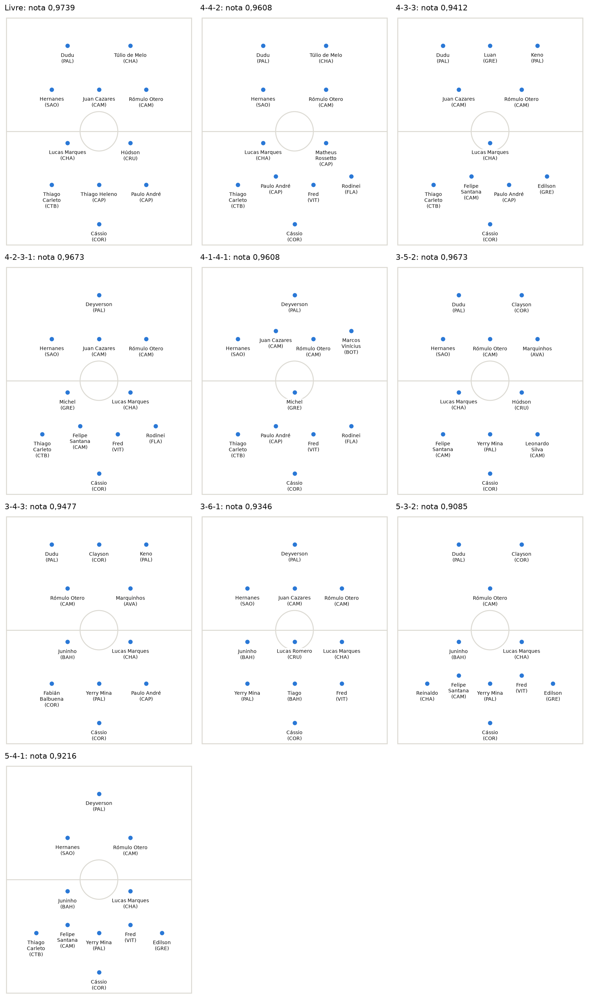
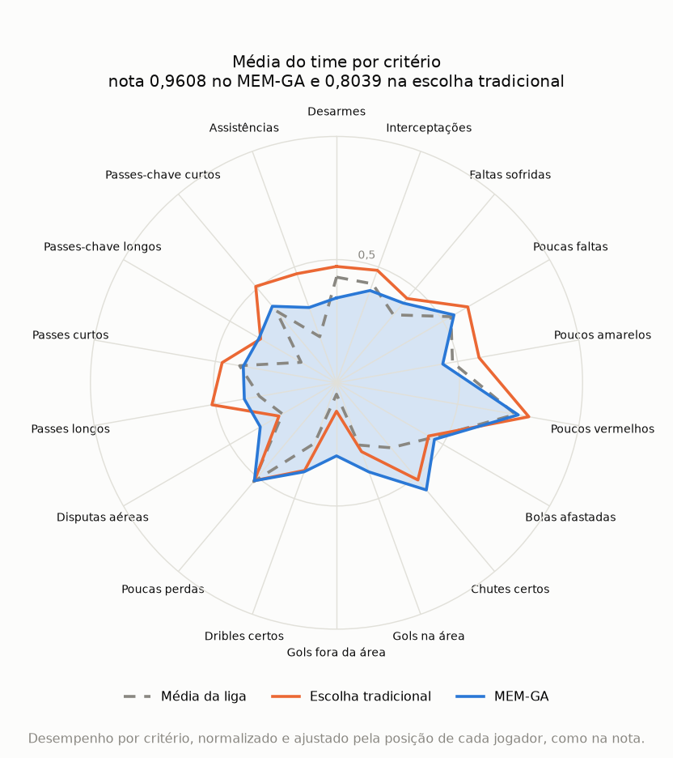

# Lineup (MEM-GA)

*Read in: [Português](README.md)*

Builds a football team from player statistics by combining the Multiple Choice Method (MEM) with a genetic algorithm. You choose a tactical formation, and the program searches for the players who complement each other best.

The project began in my master's dissertation and uses data from the 2017 Brazilian Championship, with 317 outfield players with at least 850 minutes and 25 goalkeepers with 850 minutes or more.



Part of [football-analytics](../README.en.md). The generic method lives in [mem-ga](../../mem-ga/README.en.md), with examples outside football. The sibling project, [signings](../contratacoes/README.en.md), suggests signings for a club with the same score. The [full analysis](analise.ipynb), in Portuguese, shows the team for each formation and why the most complementary team is not the 10 strongest players.

## The method

1. **Prepare the data.** Players with at least 850 minutes enter, about 25% of the championship. Each statistic is converted to a per-90-minutes value and normalized from 0 to 1, from the worst to the best player on that criterion. For cost criteria, such as fouls and cards, the scale is inverted, so 1 is always the best performance.
2. **Calculate complementarity between criteria.** It is 1 minus the absolute correlation between two criteria, calculated within each position. Criteria that move together, such as shots on target and goals, complement each other little.
3. **Calculate position weights.** Each criterion starts at 1 and gains as much as the position does it more than the others. Clearances weigh more for center-backs, and goals in the box for forwards.
4. **Build the criteria pairs.** The method generates every pair of the 18 criteria, 153 in total.
5. **Calculate the team's value in each pair.** First, it takes the team's average on each criterion, using each player's position weights. The pair's value is the lower of the two averages, multiplied by the average weight of the two criteria and by the complementarity between them.
6. **Calculate the team's score.** A pair passes when its value reaches tau, the group threshold. The score is the share of the 153 pairs that pass.
7. **Search for the best team.** The genetic algorithm draws 60 teams and repeats 15,000 iterations:
   - It crosses two teams and draws a new one from their players, respecting the formation's quotas.
   - It adds the new team to the population and removes the worst.
   - After 14 iterations without improvement, it runs a mutation round, with up to 7 attempts to swap a player on the best team for another in the same position.
   - Every 5 mutation rounds, it runs a strong mutation: it swaps 3 players at once and then climbs swap by swap, changing one player at a time while the score improves. This takes the search out of teams where no single swap improves the score.
8. **Choose the goalkeeper.** Goalkeepers have different statistics, so they stay out of the criteria pairs. They are judged on three criteria: save rate, long pass accuracy, and clearances per 90 minutes. The winner reaches the most criteria by ranking in the top 20% of each, with ties broken by save rate.

As a formula, for each pair of criteria `(j, j')`:

```text
mean(j)     = average, over the team's players, of performance on j x position weight on j
value(j,j') = minimum(mean(j), mean(j')) x (weight[j] + weight[j']) / 2 x complementarity[j, j']
pass(j,j')  = 1 if value(j,j') >= tau, otherwise 0
score       = sum of pass / 153
```

Here, `weight` is the criterion's base weight, in `criteria.csv`.

When scores tie, the team that gets closest to tau on the pairs that do not pass yet wins. The tiebreak is the average of the 153 values, with each value capped at tau. This gives the algorithm a direction, because the score only changes when a whole pair passes. Different teams can have the same score, and the program shows the best one by the tiebreak.

A pair only passes if the team is good on both criteria, so a strong criterion does not make up for a weak one. Below tau, reinforcing the pair's weak criterion helps, even if the reinforcement comes from someone who repeats what a teammate already does. Above tau, more of the same adds nothing. So a player's value depends on the team they join: they are worth more when covering what the others lack, not only for what they do alone.

The default tau is 0.24. With it, the median club's starters pass 0.458 of the pairs, and the best team found reaches 0.9739, so the score still separates teams. With other data, tau needs recalibrating, and the [results](#results) show what changes with it.

The score is the `minimo` rule from [mem-ga](../../mem-ga/README.en.md), and the search is its genetic algorithm, with the position as the group and the formation as quotas per position. The mem-ga README explains [why the rule uses criteria in pairs and the minimum](../../mem-ga/README.en.md#the-two-rules), instead of the thesis's mean n at a time.

## How to run

Install the dependencies as in the [football-analytics README](../README.en.md#installation). Then, from the `football-analytics` folder, run:

```bash
python -m escalacao
```

The program asks for the formation. It accepts a shortcut, a formation you build yourself, or nothing, for a free team:

```text
Qual formação você quer? 4-3-3
Qual formação você quer? zag=3,le=1,ld=1,vol=3,mei=1,ata=1
```

The prompts and output are in Portuguese. The position codes are ZAG (center-back), LE (left-back), LD (right-back), VOL (defensive midfielder), MEI (attacking midfielder), and ATA (forward).

The shortcuts live in `PRESETS`, in [`formacoes.py`](formacoes.py):

| Formation | ZAG | LE | LD | VOL | MEI | ATA |
| --- | --- | --- | --- | --- | --- | --- |
| 4-4-2 | 2 | 1 | 1 | 2 | 2 | 2 |
| 4-3-3 | 2 | 1 | 1 | 1 | 2 | 3 |
| 4-2-3-1 | 2 | 1 | 1 | 2 | 3 | 1 |
| 4-1-4-1 | 2 | 1 | 1 | 1 | 4 | 1 |
| 3-5-2 | 3 | 0 | 0 | 2 | 3 | 2 |
| 3-4-3 | 3 | 0 | 0 | 2 | 2 | 3 |
| 3-6-1 | 3 | 0 | 0 | 3 | 3 | 1 |
| 5-3-2 | 3 | 1 | 1 | 2 | 1 | 2 |
| 5-4-1 | 3 | 1 | 1 | 2 | 2 | 1 |

With three at the back, the team uses no full-backs. With five, it uses three center-backs and two full-backs. You can also type without hyphens, such as `4141`.

The formation sets the 10 outfield players, and the goalkeeper is chosen separately.

While it runs, a bar shows the current iteration and the best score. At the end, the result appears as a lineup, followed by a list with each player's position and the sum of their performance on the 18 criteria, from 0 to 18:

```text
+-------------------------------[     ]--------------------------------+
|                                                                      |
|              Dudu (PAL)              Túlio de Melo (CHA)             |
|                                                                      |
|             Hernanes (SAO)             Rómulo Otero (CAM)            |
|                                                                      |
|----------------------------------o-----------------------------------|
|                                                                      |
|          Lucas Marques (CHA)          Matheus Rossetto (CAP)         |
|                                                                      |
|  Thiago Carleto (CTB)  Paulo André (CAP)  Fred (VIT)  Rodinei (FLA)  |
|                                                                      |
|                             Cássio (COR)                             |
|                                                                      |
+-------------------------------[     ]--------------------------------+
```

Each run takes about 10 to 25 seconds for formations and about 40 seconds for the free team, on an idle machine. With other heavy processes running, it takes longer and can go past 60 seconds. To skip the question and repeat a result, use `--formation` and `--seed`. To change the group threshold, use `--tau`, and to change the minimum minutes, use `--min-minutes`. The other options are listed by `python -m escalacao --help`.

At the end, the team's radar chart opens in a separate window, and the program ends when you close it. To save the chart to a file, use `--radar`, as in `python -m escalacao --formation 4-4-2 --seed 1 --radar radar.png`. To skip the window, use `--no-plot`.

Raising `--iterations` to 20,000 or more can make a run much slower in some formations. The 4-1-4-1 reached 105 seconds with 20,000 iterations and 357 seconds with 30,000, in 10 parallel processes.

To run the tests:

```bash
python -m pytest
```

## Results

Best known score with the 2017 data, using a tau of 0.24. Each formation ran 60 times, with different seeds, and the table counts how many runs reached that score. Seeds 0 to 29 were used to choose the search configuration. Seeds 30 to 59 only ran after that choice, so they are the honest check.

| Formation | Score | Pairs passed | Hits, seeds 0 to 29 | Hits, seeds 30 to 59 | Worst score |
| --- | --- | --- | --- | --- | --- |
| Free | 0.9739 | 149 of 153 | 30 of 30 | 30 of 30 | 0.9739 |
| 4-2-3-1 | 0.9673 | 148 of 153 | 30 of 30 | 30 of 30 | 0.9673 |
| 3-5-2 | 0.9673 | 148 of 153 | 28 of 30 | 29 of 30 | 0.9608 |
| 4-4-2 | 0.9608 | 147 of 153 | 30 of 30 | 30 of 30 | 0.9608 |
| 4-1-4-1 | 0.9608 | 147 of 153 | 30 of 30 | 30 of 30 | 0.9608 |
| 3-4-3 | 0.9477 | 145 of 153 | 30 of 30 | 30 of 30 | 0.9477 |
| 4-3-3 | 0.9412 | 144 of 153 | 29 of 30 | 30 of 30 | 0.9346 |
| 3-6-1 | 0.9346 | 143 of 153 | 30 of 30 | 30 of 30 | 0.9346 |
| 5-4-1 | 0.9216 | 141 of 153 | 30 of 30 | 29 of 30 | 0.9150 |
| 5-3-2 | 0.9085 | 139 of 153 | 27 of 30 | 28 of 30 | 0.8693 |

In total, the search reached the best known score in 294 of 300 runs on seeds 0 to 29, and in 296 of 300 on the new seeds. The largest drop is in the 5-3-2: the run that fails stops at 0.8693, against the best of 0.9085. This happened in 3 of 30 runs, and in 2 of 30 on the new seeds. So it is worth repeating the formation with other seeds.

The best known score is the highest found in these runs, in another 30 from a different search configuration, and in 200 swap-by-swap climbs from random teams. Those climbs, without the genetic algorithm, reached the same score in 8 of the 10 formations and fell short in the 4-3-3 and the 5-4-1. The global optimum was not proven, so a team with a higher score may exist.

### Traditional choice and group formation

To show what group formation changes, the MEM-GA team is compared with the traditional choice: rating each player alone and keeping the best ones. In that choice, each player gets a summed performance:

1. **Normalize each criterion.** Each of the 18 criteria goes from 0 to 1 across the 317 outfield players: the league's best on that criterion gets 1 and the worst gets 0. For criteria where less is better, such as fouls, cards, and lost balls, the scale flips, so 1 is still the best.
2. **Add up the 18 grades.** The sum has no weights and no position adjustment, and goes from 0 to 18. Hernanes, for example, sums 8.96.
3. **Fill the slots.** Each slot in the formation takes the players with the highest sum in that position. In the 4-4-2, that means the 2 best center-backs, the best full-back on each side, the 2 best defensive midfielders, the 2 best midfielders, and the 2 best forwards. In the free team, it is the 10 highest sums, regardless of position.

No step looks at what the other players already cover. Group formation does the opposite: a player's value depends on the rest of the team.

| Formation | Traditional choice | MEM-GA |
| --- | --- | --- |
| Free | 0.6863 | 0.9739 |
| 4-4-2 | 0.8039 | 0.9608 |

The radar chart shows this difference in the 4-4-2. Each axis is a criterion, and each line is the average of the team's 10 players, using the values the score uses, already adjusted by position. The orange line is the traditional choice, the blue area is MEM-GA, and the dashed line is the league average. The chart labels are in Portuguese, like the program's output.



The traditional choice has higher averages in tackles, passes, and assists, but stays low in goals from outside the box (0.12) and aerial duels (0.27). That happens because a high sum can hide a weak spot. Luan (GRE) sums 7.63 and gets a forward slot, but barely wins anything in the air (0.03). MEM-GA puts Túlio de Melo (CHA) in his place, with a lower sum of 6.71 and 0.92 in aerial duels. In the same way, it swaps Gustavo Scarpa (FLU), with 0.09 in goals from outside the box, for Rómulo Otero (CAM), with 1.22. The two teams share only 3 players.

As a result, MEM-GA gives up part of the peaks and raises the weak spots to 0.30 in goals from outside the box and 0.36 in aerial duels. Since the score looks at the weaker criterion of each pair, that is worth more than high numbers where the team is already good.

### Tau sensitivity

The table shows what changes between 0.22 and 0.26. Changes are the players who differ from the team at 0.24, and the club columns use the score of the starters of the 20 clubs.

| Tau | 4-4-2 score | 4-4-2 changes | Free score | Free changes | Median club | Worst club | Best club |
| --- | --- | --- | --- | --- | --- | --- | --- |
| 0.22 | 0.9869 | 4 | 0.9935 | 4 | 0.542 | 0.359 | 0.725 |
| 0.23 | 0.9804 | 4 | 0.9869 | 4 | 0.484 | 0.294 | 0.667 |
| 0.24 | 0.9608 | 0 | 0.9739 | 0 | 0.458 | 0.281 | 0.608 |
| 0.25 | 0.9346 | 1 | 0.9608 | 4 | 0.408 | 0.242 | 0.569 |
| 0.26 | 0.9085 | 1 | 0.9412 | 3 | 0.373 | 0.216 | 0.562 |

In this range, no score reaches 1 and the best team changes up to 4 of its 10 players. Values other than 0.24 are the best score from 10 seeds and 200 climbs, with no convergence measure. The search was calibrated only at 0.24, so those teams may not be the best for that tau. At 0.26, in the 4-4-2, only 5 of the 10 seeds reached 0.9085, and the others stayed at 0.8693.

## Sources

Player statistics come from [WhoScored](https://www.whoscored.com/), as the data's [FONTE.en.md](../dados/brasileirao-2017/FONTE.en.md) explains.

The position weights draw on the idea that indicators are nearly the same across positions, and what changes is the priority of each one (Hughes et al., 2012). Complementarity uses the conflict measure of the [CRITIC](https://doi.org/10.1016/0305-0548(94)00059-H) method (Diakoulaki, Mavrotas and Papayannakis, 1995).

The project builds on the dissertation *MEM-GA: Método de Escolha Múltipla com Algoritmo Genético aplicado à formação de equipes de futebol*, by Sérgio Augusto Faria Salles, at the Instituto Federal Fluminense (2018). MEM was proposed in the thesis *Método de Escolha Múltipla: uma proposta multicritério para seleção em conjunto de mais de uma alternativa*, by Henrique Rego Monteiro da Hora, at the Universidade Federal Fluminense (2013), and also appears in da Hora and Costa (2015).

## Limitations

The global optimum was not proven. The scores are the best known, and the search does not always reach them. There is also no validation that these teams would win more matches, because the score measures complementarity in the statistics, not results on the pitch.

The weight shows what each position does most, which does not prove it decides matches. The team only considers the 2017 season, and the goalkeeper stays outside the complementarity analysis. The data also does not measure how hard the shots they faced were. The score depends on the chosen tau, and the best team changes with it.
