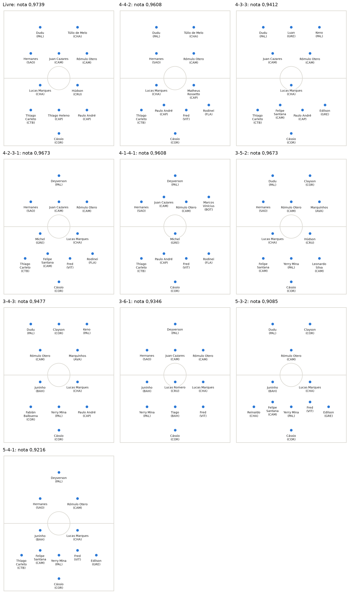
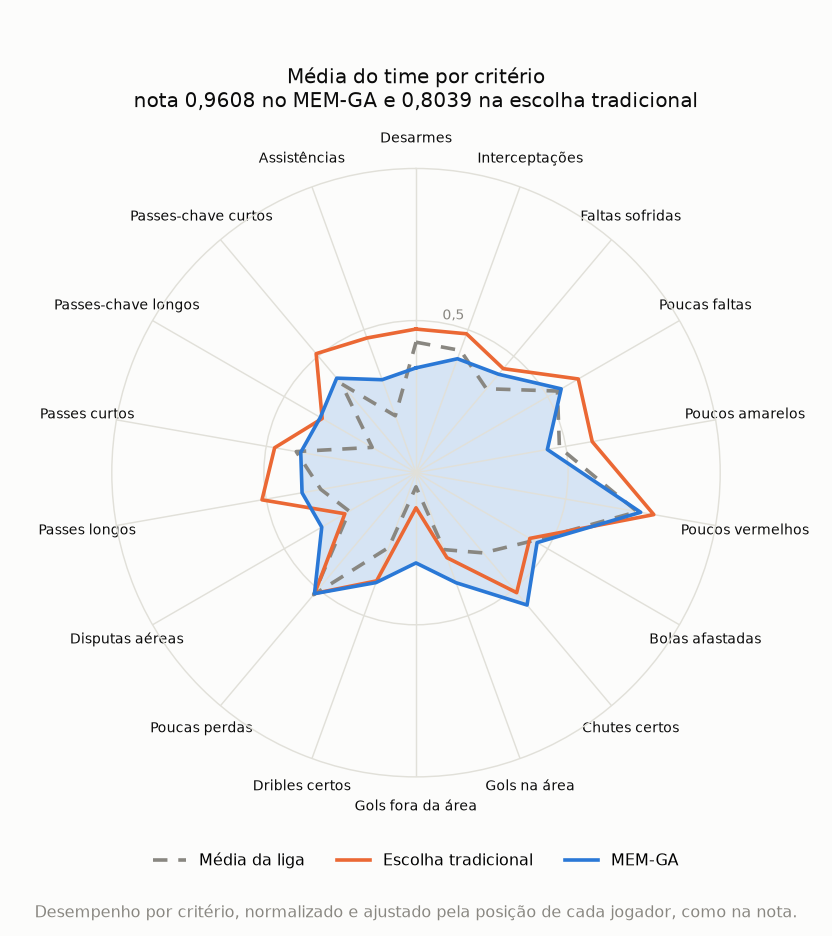

# Escalação (MEM-GA)

*Leia em: [English](README.en.md)*

Monta um time de futebol a partir das estatísticas dos jogadores, combinando o Método de Escolha Múltipla (MEM) com um algoritmo genético. A pessoa escolhe a formação tática, e o programa procura os jogadores que se complementam melhor.

O projeto nasceu na minha dissertação de mestrado e usa dados do Campeonato Brasileiro de 2017, com 317 jogadores de linha com pelo menos 850 minutos e 25 goleiros com 850 minutos ou mais.



Faz parte do [football-analytics](../README.md). O método genérico fica no [mem-ga](https://github.com/safsalles/mem-ga), com exemplos fora do futebol. O projeto vizinho, [contratações](../contratacoes/README.md), sugere contratações para um clube com a mesma nota. A [análise completa](analise.ipynb) mostra os times de cada formação e por que o time mais complementar não é o dos 10 jogadores mais fortes.

## O método

1. **Prepara os dados.** Entram os jogadores com pelo menos 850 minutos, cerca de 25% do campeonato. Cada estatística é convertida para valor por 90 minutos e normalizada de 0 a 1, do pior ao melhor jogador naquele critério. Nos critérios de custo, como faltas e cartões, a escala é invertida, então 1 sempre é o melhor desempenho.
2. **Calcula a complementação entre critérios.** É 1 menos a correlação entre dois critérios, em módulo, calculada dentro de cada posição. Critérios que andam juntos, como chutes certos e gols, se complementam pouco.
3. **Calcula os pesos por posição.** Cada critério parte de 1 e ganha o quanto a posição faz aquilo acima das outras. Bolas afastadas pesam mais para zagueiros, e gols na área, para atacantes.
4. **Monta os pares de critérios.** O método gera todos os pares dos 18 critérios, 153 no total.
5. **Calcula o valor do time em cada par.** Primeiro, tira a média do time em cada critério, já com o peso da posição de cada jogador. O valor do par é a menor das duas médias, multiplicada pelo peso médio dos dois critérios e pela complementação entre eles.
6. **Calcula a nota do time.** Um par passa quando o valor alcança o tau, o corte do grupo. A nota é a fração dos 153 pares que passam.
7. **Procura o melhor time.** O algoritmo genético sorteia 60 times e repete 15.000 iterações:
   - Cruza dois times e sorteia um novo entre os jogadores deles, respeitando as quotas da formação.
   - Coloca o novo time na população e retira o pior.
   - Depois de 14 iterações sem melhora, faz uma rodada de mutação, com até 7 tentativas de trocar um jogador do melhor time por outro da mesma posição.
   - A cada 5 rodadas de mutação, faz uma mutação forte: troca 3 jogadores de uma vez e depois sobe troca a troca, mudando um jogador por vez enquanto a nota melhorar. Isso tira a busca de times em que nenhuma troca de um jogador só melhora a nota.
8. **Escolhe o goleiro.** Como as estatísticas dele são outras, o goleiro fica fora dos pares de critérios. Ele é avaliado por três critérios: aproveitamento de defesas, acerto de passes longos e bolas afastadas por 90 minutos. Vence quem atinge mais critérios, ficando entre os 20% melhores em cada um, com desempate pelo aproveitamento de defesas.

Em fórmula, para cada par de critérios `(j, j')`:

```text
média(j)    = média, nos jogadores do time, do desempenho em j x peso da posição em j
valor(j,j') = mínimo(média(j), média(j')) x (peso[j] + peso[j']) / 2 x complementação[j, j']
passa(j,j') = 1 se valor(j,j') >= tau, senão 0
nota        = soma de passa / 153
```

Aqui, `peso` é o peso base do critério, em `criteria.csv`.

Em caso de empate na nota, vence o time que chega mais perto do tau nos pares que ainda não passam. O desempate é a média dos 153 valores, com cada valor limitado ao tau. Isso dá uma direção ao algoritmo, porque a nota só muda quando um par inteiro passa. Times diferentes podem ter a mesma nota, e o programa mostra o melhor pelo desempate.

Um par só passa se o time for bom nos dois critérios, então um critério forte não compensa o fraco. Abaixo do tau, reforçar o critério fraco do par ajuda, mesmo que o reforço venha de quem repete o que um companheiro já faz. Acima do tau, mais do mesmo não soma nada. Por isso, o valor de um jogador depende do time em que ele entra: ele vale mais quando cobre o que falta aos outros, e não só pelo que faz sozinho.

O tau padrão é 0,24. Com ele, os titulares do clube mediano passam em 0,458 dos pares, e o melhor time encontrado fica em 0,9739, então a nota ainda diferencia os times. Com outros dados, é preciso recalibrar o tau, e os [resultados](#resultados) mostram o que muda com ele.

A nota é a regra `minimo` do [mem-ga](https://github.com/safsalles/mem-ga), e a busca é o algoritmo genético de lá, com a posição no papel de grupo e a formação como vagas por posição. O README do mem-ga explica [por que a regra usa os critérios dois a dois e o mínimo](https://github.com/safsalles/mem-ga#as-duas-regras), em vez da média n a n da tese.

## Como rodar

Instale as dependências como no [README do repositório](../README.md#instalação). Depois, a partir da pasta do repositório, execute:

```bash
python -m escalacao
```

O programa pergunta a formação. Aceita um atalho, uma formação montada por você ou nada, para o time livre:

```text
Qual formação você quer? 4-3-3
Qual formação você quer? zag=3,le=1,ld=1,vol=3,mei=1,ata=1
```

Os atalhos ficam em `PRESETS`, no arquivo [`formacoes.py`](formacoes.py):

| Formação | ZAG | LE | LD | VOL | MEI | ATA |
| --- | --- | --- | --- | --- | --- | --- |
| 4-4-2 | 2 | 1 | 1 | 2 | 2 | 2 |
| 4-3-3 | 2 | 1 | 1 | 1 | 2 | 3 |
| 4-2-3-1 | 2 | 1 | 1 | 2 | 3 | 1 |
| 4-1-4-1 | 2 | 1 | 1 | 1 | 4 | 1 |
| 3-5-2 | 3 | 0 | 0 | 2 | 3 | 2 |
| 3-4-3 | 3 | 0 | 0 | 2 | 2 | 3 |
| 3-6-1 | 3 | 0 | 0 | 3 | 3 | 1 |
| 5-3-2 | 3 | 1 | 1 | 2 | 1 | 2 |
| 5-4-1 | 3 | 1 | 1 | 2 | 2 | 1 |

Com três na defesa, o time não usa laterais. Com cinco, são três zagueiros e dois laterais. Também dá para digitar sem os hifens, como `4141`.

A formação define os 10 jogadores de linha, e o goleiro é escolhido à parte.

Durante a execução, uma barra mostra a iteração atual e a melhor nota. No fim, o resultado aparece em formato de escalação, seguido da lista com a posição de cada jogador e a soma do desempenho dele nos 18 critérios, de 0 a 18:

```text
+-------------------------------[     ]--------------------------------+
|                                                                      |
|              Dudu (PAL)              Túlio de Melo (CHA)             |
|                                                                      |
|             Hernanes (SAO)             Rómulo Otero (CAM)            |
|                                                                      |
|----------------------------------o-----------------------------------|
|                                                                      |
|          Lucas Marques (CHA)          Matheus Rossetto (CAP)         |
|                                                                      |
|  Thiago Carleto (CTB)  Paulo André (CAP)  Fred (VIT)  Rodinei (FLA)  |
|                                                                      |
|                             Cássio (COR)                             |
|                                                                      |
+-------------------------------[     ]--------------------------------+
```

Cada execução leva cerca de 10 a 25 segundos nas formações e cerca de 40 segundos no time livre, em máquina livre. Com outros processos pesados rodando, leva mais tempo e pode passar de 60 segundos. Para pular a pergunta e repetir um resultado, use `--formation` e `--seed`. Para mudar o corte do grupo, use `--tau`, e para mudar o mínimo de minutos, use `--min-minutes`. As demais opções aparecem em `python -m escalacao --help`.

No final, o gráfico de radar do time abre em outra janela, e o programa termina quando ela é fechada. Para salvar o gráfico em um arquivo, use `--radar`, como em `python -m escalacao --formation 4-4-2 --seed 1 --radar radar.png`. Para não abrir a janela, use `--no-plot`.

Subir `--iterations` para 20.000 ou mais pode deixar a execução bem mais lenta em algumas formações. O 4-1-4-1 chegou a 105 segundos com 20.000 iterações e a 357 segundos com 30.000, em 10 processos paralelos.

Para rodar os testes, também a partir da pasta do repositório:

```bash
python -m pytest
```

## Resultados

Melhor nota conhecida com os dados de 2017, usando o tau de 0,24. Cada formação rodou 60 vezes, com sementes diferentes, e a tabela conta quantas execuções chegaram a essa nota. As sementes 0 a 29 foram usadas para escolher a configuração da busca. As sementes 30 a 59 só rodaram depois da escolha, então são a checagem honesta.

| Formação | Nota | Pares que passam | Acertos, sementes 0 a 29 | Acertos, sementes 30 a 59 | Pior nota |
| --- | --- | --- | --- | --- | --- |
| Livre | 0,9739 | 149 de 153 | 30 de 30 | 30 de 30 | 0,9739 |
| 4-2-3-1 | 0,9673 | 148 de 153 | 30 de 30 | 30 de 30 | 0,9673 |
| 3-5-2 | 0,9673 | 148 de 153 | 28 de 30 | 29 de 30 | 0,9608 |
| 4-4-2 | 0,9608 | 147 de 153 | 30 de 30 | 30 de 30 | 0,9608 |
| 4-1-4-1 | 0,9608 | 147 de 153 | 30 de 30 | 30 de 30 | 0,9608 |
| 3-4-3 | 0,9477 | 145 de 153 | 30 de 30 | 30 de 30 | 0,9477 |
| 4-3-3 | 0,9412 | 144 de 153 | 29 de 30 | 30 de 30 | 0,9346 |
| 3-6-1 | 0,9346 | 143 de 153 | 30 de 30 | 30 de 30 | 0,9346 |
| 5-4-1 | 0,9216 | 141 de 153 | 30 de 30 | 29 de 30 | 0,9150 |
| 5-3-2 | 0,9085 | 139 de 153 | 27 de 30 | 28 de 30 | 0,8693 |

No total, a busca chegou à melhor nota conhecida em 294 de 300 execuções nas sementes 0 a 29, e em 296 de 300 nas sementes novas. A maior queda é no 5-3-2: a execução que falha para em 0,8693, contra a melhor de 0,9085. Isso aconteceu em 3 de 30 execuções, e em 2 de 30 nas sementes novas. Por isso, vale repetir a formação com outras sementes.

A melhor nota conhecida é a maior encontrada nessas execuções, em outras 30 execuções com uma configuração diferente da busca e em 200 subidas troca a troca a partir de times sorteados. Essas subidas, sem o algoritmo genético, chegaram à mesma nota em 8 das 10 formações e ficaram abaixo no 4-3-3 e no 5-4-1. O ótimo global não foi provado, então pode existir um time com nota maior.

### Escolha tradicional e formação de grupo

Para mostrar o que a formação de grupo muda, o time do MEM-GA é comparado com a escolha tradicional: avaliar cada jogador sozinho e ficar com os melhores. Nessa escolha, cada jogador recebe um desempenho somado:

1. **Normaliza cada critério.** Cada um dos 18 critérios vai de 0 a 1 entre os 317 jogadores de linha: o melhor da liga naquele critério fica com 1 e o pior com 0. Nos critérios em que menos é melhor, como faltas, cartões e perdas de bola, a escala se inverte, e 1 continua sendo o melhor.
2. **Soma as 18 notas.** A soma não tem pesos nem ajuste por posição, e vai de 0 a 18. Hernanes, por exemplo, soma 8,96.
3. **Preenche as vagas.** Em cada vaga da formação entram os jogadores de maior soma naquela posição. No 4-4-2, são os 2 melhores zagueiros, o melhor lateral de cada lado, os 2 melhores volantes, os 2 melhores meias e os 2 melhores atacantes. No time livre, são os 10 de maior soma, sem olhar a posição.

Nenhum passo olha o que os outros jogadores já cobrem. A formação de grupo faz o contrário: o valor de um jogador depende do resto do time.

| Formação | Escolha tradicional | MEM-GA |
| --- | --- | --- |
| Livre | 0,6863 | 0,9739 |
| 4-4-2 | 0,8039 | 0,9608 |

O radar mostra essa diferença no 4-4-2. Cada eixo é um critério, e cada linha é a média dos 10 jogadores do time, com os valores que a nota usa, já ajustados pela posição. A linha laranja é a escolha tradicional, a área azul é o MEM-GA e a linha tracejada é a média da liga.



A escolha tradicional tem médias maiores em desarmes, passes e assistências, mas fica baixa em gols fora da área (0,12) e disputas aéreas (0,27). Isso acontece porque uma soma alta pode esconder um ponto fraco. Luan (GRE) tem soma 7,63 e entra no ataque, mas quase não ganha bola pelo alto (0,03). O MEM-GA põe no lugar dele Túlio de Melo (CHA), com soma menor, de 6,71, e 0,92 em disputas aéreas. Da mesma forma, troca Gustavo Scarpa (FLU), com 0,09 em gols fora da área, por Rómulo Otero (CAM), com 1,22. Os dois times têm só 3 jogadores em comum.

Com isso, o MEM-GA abre mão de parte dos picos e sobe os pontos fracos para 0,30 em gols fora da área e 0,36 em disputas aéreas. Como a nota olha o critério mais fraco de cada par, isso vale mais do que números altos onde o time já é bom.

### Sensibilidade do tau

A tabela mostra o que muda entre 0,22 e 0,26. As mudanças são os jogadores diferentes do time de 0,24, e as colunas de clubes usam a nota dos titulares dos 20 clubes.

| Tau | Nota 4-4-2 | Mudanças 4-4-2 | Nota livre | Mudanças livre | Mediana dos clubes | Pior clube | Melhor clube |
| --- | --- | --- | --- | --- | --- | --- | --- |
| 0,22 | 0,9869 | 4 | 0,9935 | 4 | 0,542 | 0,359 | 0,725 |
| 0,23 | 0,9804 | 4 | 0,9869 | 4 | 0,484 | 0,294 | 0,667 |
| 0,24 | 0,9608 | 0 | 0,9739 | 0 | 0,458 | 0,281 | 0,608 |
| 0,25 | 0,9346 | 1 | 0,9608 | 4 | 0,408 | 0,242 | 0,569 |
| 0,26 | 0,9085 | 1 | 0,9412 | 3 | 0,373 | 0,216 | 0,562 |

Nessa faixa, nenhuma nota chega a 1 e o melhor time troca até 4 dos 10 jogadores. Os valores fora de 0,24 são a melhor nota de 10 sementes e 200 subidas, sem medida de convergência. A busca foi calibrada só em 0,24, então esses times podem não ser os melhores daquele tau. Em 0,26, no 4-4-2, só 5 das 10 sementes chegaram a 0,9085, e as outras ficaram em 0,8693.

## Fontes

As estatísticas dos jogadores vêm do [WhoScored](https://www.whoscored.com/), como explica o [FONTE.md](../dados/brasileirao-2017/FONTE.md) dos dados.

Os pesos por posição se inspiram na ideia de que os indicadores são quase os mesmos entre as posições, e o que muda é a prioridade de cada um (Hughes et al., 2012). A complementação usa a medida de conflito do método [CRITIC](https://doi.org/10.1016/0305-0548(94)00059-H) (Diakoulaki, Mavrotas e Papayannakis, 1995).

O projeto parte da dissertação *MEM-GA: Método de Escolha Múltipla com Algoritmo Genético aplicado à formação de equipes de futebol*, de Sérgio Augusto Faria Salles, no Instituto Federal Fluminense (2018). O MEM foi proposto na tese *Método de Escolha Múltipla: uma proposta multicritério para seleção em conjunto de mais de uma alternativa*, de Henrique Rego Monteiro da Hora, na Universidade Federal Fluminense (2013), e também aparece em da Hora e Costa (2015).

## Limitações

O ótimo global não foi provado. As notas são as melhores conhecidas, e a busca nem sempre chega a elas. Também não há validação de que esses times ganhariam mais jogos, porque a nota mede a complementação nas estatísticas, e não o resultado em campo.

O peso mostra o que cada posição mais faz, o que não prova que aquilo decide jogos. O time só considera a temporada de 2017, e o goleiro fica fora da análise de complementação. Os dados também não medem a dificuldade dos chutes que ele enfrentou. A nota depende do tau escolhido, e o melhor time muda com ele.
