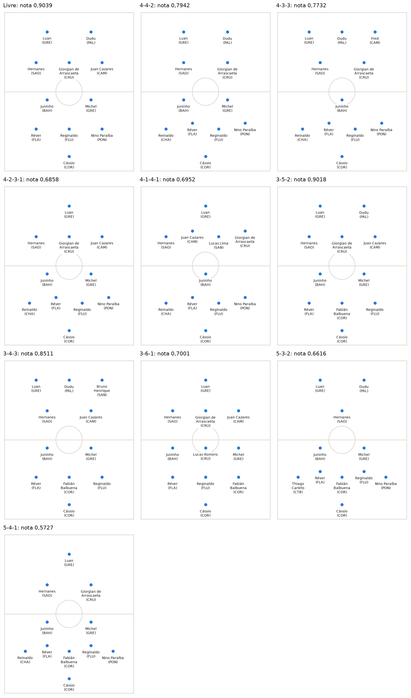

# MEM-GA

*Read in: [Português](README.md)*

Builds a football team from player statistics by combining the Multiple Choice Method (MEM) with a genetic algorithm. You choose a tactical formation, and the program searches for the players who complement each other best.

The project began in my master's dissertation and uses data from the 2017 Brazilian Championship, with 317 outfield players and 26 goalkeepers.



The [full analysis](analise.ipynb), in Portuguese, shows the team for each formation and why the most complementary team is not the 10 strongest players.

## The method

1. **Prepare the data.** Players with at least 850 minutes enter, about 25% of the championship. Each statistic is converted to a per-90-minutes value and becomes 0 or 1 through a cut that leaves about 20% of players above it. For cost criteria, such as fouls and cards, the scale is inverted, so 1 is always the best performance.
2. **Calculate complementarity between criteria.** It is 1 minus the absolute correlation between two criteria, calculated within each position. Criteria that move together, such as shots on target and goals, complement each other little.
3. **Calculate position weights.** Each criterion starts at 1 and gains as much as the position does it more than the others. Clearances weigh more for center-backs, and goals in the box for forwards.
4. **Build the combinations.** The method generates every combination of 10 of the 18 criteria, 43,758 in total.
5. **Calculate the team's value in each combination.** The value is the players' average performance on those criteria, using each player's position weights, multiplied by the combination's average complementarity.
6. **Calculate the team's score.** The score is the share of combinations in which the value reaches tau, the group cut.
7. **Search for the best team.** The genetic algorithm draws 60 teams and repeats 10,000 iterations:
   - It crosses two teams and draws a new one from their players, respecting the formation's quotas.
   - It adds the new team to the population and removes the worst.
   - After 14 iterations without improvement, it tries up to 7 mutations, swapping a player on the best team for another in the same position.
8. **Choose the goalkeeper.** Goalkeepers have different statistics, so they stay out of the combinations. They are judged on three criteria: save rate, long pass accuracy, and clearances per 90 minutes. The winner reaches the most criteria by ranking in the top 20% of each, with ties broken by save rate.

When scores tie, the team with the higher average value wins. This gives the algorithm a direction at the start, when almost every random team scores zero.

Because the score is calculated for the group, a team with weak spots fails every combination that includes them. A player is worth more when covering what the others lack, not only for what they do alone.

The default tau is 0.54. Up to about 0.50, the best team reaches almost every combination, and the score stops separating teams.

## How to run

From the `mem-ga` folder, install the dependencies:

```bash
pip install -r requirements.txt
```

Then run:

```bash
python mem_ga.py
```

The program asks for the formation. It accepts a shortcut, a formation you build yourself, or nothing, for a free team:

```text
Qual formação você quer? 4-3-3
Qual formação você quer? zag=3,le=1,ld=1,vol=3,mei=1,ata=1
```

The prompts and output are in Portuguese. The position codes are ZAG (center-back), LE (left-back), LD (right-back), VOL (defensive midfielder), MEI (attacking midfielder), and ATA (forward).

The shortcuts live in `PRESETS`, in `mem_ga.py`:

| Formation | ZAG | LE | LD | VOL | MEI | ATA |
| --- | --- | --- | --- | --- | --- | --- |
| 4-4-2 | 2 | 1 | 1 | 2 | 2 | 2 |
| 4-3-3 | 2 | 1 | 1 | 1 | 2 | 3 |
| 4-2-3-1 | 2 | 1 | 1 | 2 | 3 | 1 |
| 4-1-4-1 | 2 | 1 | 1 | 1 | 4 | 1 |
| 3-5-2 | 3 | 0 | 0 | 2 | 3 | 2 |
| 3-4-3 | 3 | 0 | 0 | 2 | 2 | 3 |
| 3-6-1 | 3 | 0 | 0 | 3 | 3 | 1 |
| 5-3-2 | 3 | 1 | 1 | 2 | 1 | 2 |
| 5-4-1 | 3 | 1 | 1 | 2 | 2 | 1 |

With three at the back, the team uses no full-backs. With five, it uses three center-backs and two full-backs. You can also type without hyphens, such as `4141`.

The formation sets the 10 outfield players, and the goalkeeper is chosen separately.

While it runs, a bar shows the current iteration and the best score. At the end, the result appears as a lineup, followed by a list with each player's position and how many criteria they reached:

```text
+------------------------------[     ]-------------------------------+
|                                                                    |
|                Luan (GRE)                Dudu (PAL)                |
|                                                                    |
|         Hernanes (SAO)         Giorgian de Arrascaeta (CRU)        |
|                                                                    |
|---------------------------------o----------------------------------|
|                                                                    |
|               Juninho (BAH)              Michel (GRE)              |
|                                                                    |
|  Reinaldo (CHA)  Réver (FLA)  Reginaldo (FLU)  Nino Paraíba (PON)  |
|                                                                    |
|                            Cássio (COR)                            |
|                                                                    |
+------------------------------[     ]-------------------------------+
```

Each run takes about 5 seconds. To skip the question and repeat a result, use `--formation` and `--seed`. To change the group cut, use `--tau`, and to change the minimum minutes, use `--min-minutes`. The other options are listed by `python mem_ga.py --help`.

To run the tests:

```bash
python -m pytest
```

## Data format

The program reads UTF-8 CSV files from the `data/` folder. To use other data, create a folder with the same files and run `python mem_ga.py --data my_folder`.

### `players.csv`

One row per player.

| Column | Content |
| --- | --- |
| `player` | Player name |
| `team` | Club code, shown in parentheses next to the name |
| `position` | Position code, used by the formation quotas |
| `minutes` | Minutes played in the season |
| one column per criterion | Season total, with the same name used in `criteria.csv`. The program converts it to a per-90-minutes value |

```csv
player,team,position,minutes,Tackles,Interception,...
Alecsandro,CTB,ATA,827,15,5,...
```

### `criteria.csv`

One row per criterion.

| Column | Content |
| --- | --- |
| `criterion` | Criterion name |
| `direction` | `1` when more is better and `0` when more is worse |
| `weight` | Base criterion weight, applied together with the position weight. Use 1 to keep only the position weight |
| `cut` | Cut on the per-90-minutes value. Values equal to or above it become 1. If blank, the criterion is only normalized between 0 and 1 |

```csv
criterion,direction,weight,cut
Tackles,1,1,2.266
Fouls,0,1,2.019
```

### `goalkeepers.csv`

Optional file, with one row per goalkeeper. Without it, the team has only outfield players.

| Column | Content |
| --- | --- |
| `player` | Goalkeeper name |
| `team` | Club code |
| `minutes` | Minutes played in the season |
| `saves` | Saves |
| `goals_conceded` | Goals conceded |
| `long_passes_accurate` | Accurate long passes |
| `long_passes_inaccurate` | Inaccurate long passes |
| `clearances` | Clearances |

```csv
player,team,minutes,saves,goals_conceded,long_passes_accurate,long_passes_inaccurate,clearances
Aranha,PON,3330,123,51,187,384,58
```

### Rules

- The formation must add up to the team size, set by `--team-size`, which defaults to 10.
- The team size also sets how many criteria enter each combination. It must therefore be between 2 and the number of criteria.
- With other position codes, the shortcuts and the lineup drawing no longer apply. Write the formation as `position=amount`, and the result appears only as a list.
- With other data, the cuts and tau need to be calibrated again.

## Results

Best score with the 2017 data, using a tau of 0.54. Across 30 runs per formation, with different seeds, the algorithm reached the best score in 299 of 300 runs. The exception was one 4-3-3 run, which stopped at 0.7565:

| Formation | Score |
| --- | --- |
| Free | 0.9039 |
| 3-5-2 | 0.9018 |
| 3-4-3 | 0.8511 |
| 4-4-2 | 0.7942 |
| 4-3-3 | 0.7732 |
| 3-6-1 | 0.7001 |
| 4-1-4-1 | 0.6952 |
| 4-2-3-1 | 0.6858 |
| 5-3-2 | 0.6616 |
| 5-4-1 | 0.5727 |

The repetition points to a stable result, but it does not prove this is the maximum. For comparison, the 10 players who reach the most criteria individually score 0.6982, below the free team.

## Sources

The player statistics were collected manually from [WhoScored](https://www.whoscored.com/) in 2017, with the site's permission to use them in the research.

The position weights draw on the idea that indicators are nearly the same across positions, and what changes is the priority of each one (Hughes et al., 2012). Complementarity uses the conflict measure of the [CRITIC](https://doi.org/10.1016/0305-0548(94)00059-H) method (Diakoulaki, Mavrotas and Papayannakis, 1995).

The project builds on the dissertation *MEM-GA: Método de Escolha Múltipla com Algoritmo Genético aplicado à formação de equipes de futebol*, by Sérgio Augusto Faria Salles, at the Instituto Federal Fluminense (2018). MEM was proposed by da Hora and Costa (2015).

## Limitations

The weight shows what each position does most, which does not prove it decides matches. The team only considers the 2017 season, and the goalkeeper stays outside the complementarity analysis. The data also does not measure how hard the shots they faced were. The score depends on the chosen tau, and the cuts turn statistics into 0 or 1, which discards the difference between players on the same side of a cut.
