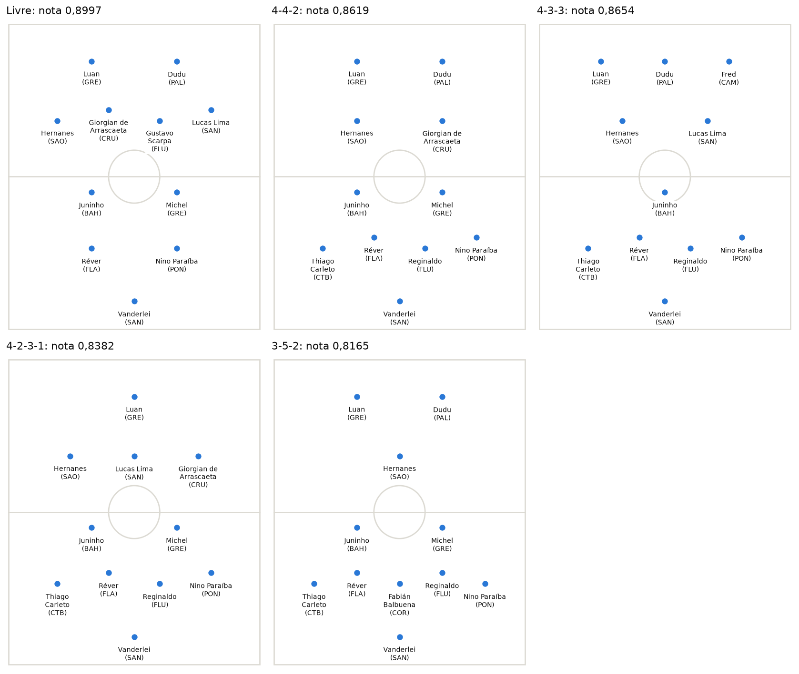
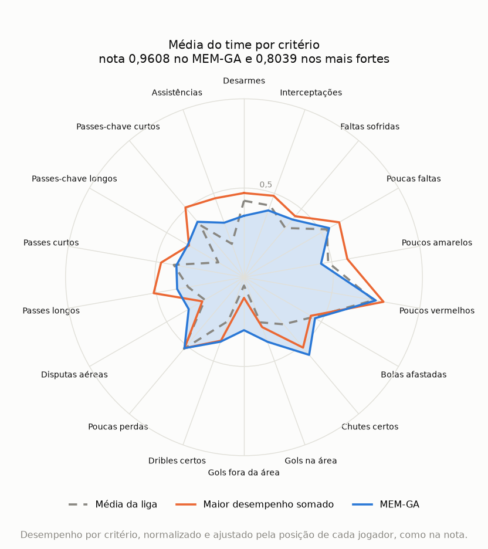
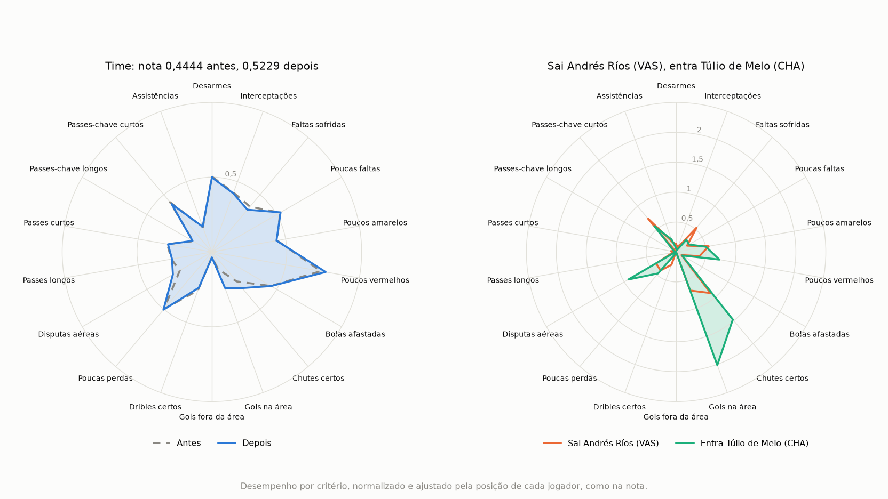

# MEM-GA

*Leia em: [English](README.en.md)*

Monta um time de futebol a partir das estatísticas dos jogadores, combinando o Método de Escolha Múltipla (MEM) com um algoritmo genético. A pessoa escolhe a formação tática, e o programa procura os jogadores que se complementam melhor.

O projeto nasceu na minha dissertação de mestrado e usa dados do Campeonato Brasileiro de 2017, com 317 jogadores de linha com pelo menos 850 minutos e 25 goleiros com 850 minutos ou mais.



A pasta [mem](../mem/) traz o método puro, sem algoritmo genético, com um exemplo pequeno e fictício. O projeto também tem o [GA-MEM](#ga-mem), que sugere contratações para um clube. A [análise completa](analise.ipynb) mostra os times de cada formação e por que o time mais complementar não é o dos 10 jogadores mais fortes.

## O método

1. **Prepara os dados.** Entram os jogadores com pelo menos 850 minutos, cerca de 25% do campeonato. Cada estatística é convertida para valor por 90 minutos e normalizada de 0 a 1, do pior ao melhor jogador naquele critério. Nos critérios de custo, como faltas e cartões, a escala é invertida, então 1 sempre é o melhor desempenho.
2. **Calcula a complementação entre critérios.** É 1 menos a correlação entre dois critérios, em módulo, calculada dentro de cada posição. Critérios que andam juntos, como chutes certos e gols, se complementam pouco.
3. **Calcula os pesos por posição.** Cada critério parte de 1 e ganha o quanto a posição faz aquilo acima das outras. Bolas afastadas pesam mais para zagueiros, e gols na área, para atacantes.
4. **Monta os pares de critérios.** O método gera todos os pares dos 18 critérios, 153 no total.
5. **Calcula o valor do time em cada par.** Primeiro, tira a média do time em cada critério, já com o peso da posição de cada jogador. O valor do par é a menor das duas médias, multiplicada pelo peso médio dos dois critérios e pela complementação entre eles.
6. **Calcula a nota do time.** Um par passa quando o valor alcança o tau, o corte do grupo. A nota é a fração dos 153 pares que passam.
7. **Procura o melhor time.** O algoritmo genético sorteia 60 times e repete 15.000 iterações:
   - Cruza dois times e sorteia um novo entre os jogadores deles, respeitando as quotas da formação.
   - Coloca o novo time na população e retira o pior.
   - Depois de 14 iterações sem melhora, faz uma rodada de mutação, com até 7 tentativas de trocar um jogador do melhor time por outro da mesma posição.
   - A cada 5 rodadas de mutação, faz uma mutação forte: troca 3 jogadores de uma vez e depois sobe troca a troca, mudando um jogador por vez enquanto a nota melhorar. Isso tira a busca de times em que nenhuma troca de um jogador só melhora a nota.
8. **Escolhe o goleiro.** Como as estatísticas dele são outras, o goleiro fica fora dos pares de critérios. Ele é avaliado por três critérios: aproveitamento de defesas, acerto de passes longos e bolas afastadas por 90 minutos. Vence quem atinge mais critérios, ficando entre os 20% melhores em cada um, com desempate pelo aproveitamento de defesas.

Em fórmula, para cada par de critérios `(j, j')`:

```text
média(j)    = média, nos jogadores do time, do desempenho em j x peso da posição em j
valor(j,j') = mínimo(média(j), média(j')) x (peso[j] + peso[j']) / 2 x complementação[j, j']
passa(j,j') = 1 se valor(j,j') >= tau, senão 0
nota        = soma de passa / 153
```

Aqui, `peso` é o peso base do critério, em `criteria.csv`.

Em caso de empate na nota, vence o time que chega mais perto do tau nos pares que ainda não passam. O desempate é a média dos 153 valores, com cada valor limitado ao tau. Isso dá uma direção ao algoritmo, porque a nota só muda quando um par inteiro passa. Times diferentes podem ter a mesma nota, e o programa mostra o melhor pelo desempate.

Um par só passa se o time for bom nos dois critérios, então um critério forte não compensa o fraco. Abaixo do tau, reforçar o critério fraco do par ajuda, mesmo que o reforço venha de quem repete o que um companheiro já faz. Acima do tau, mais do mesmo não soma nada. Por isso, o valor de um jogador depende do time em que ele entra: ele vale mais quando cobre o que falta aos outros, e não só pelo que faz sozinho.

O tau padrão é 0,24. Com ele, os titulares do clube mediano passam em 0,458 dos pares, e o melhor time encontrado fica em 0,9739, então a nota ainda diferencia os times. Com outros dados, é preciso recalibrar o tau, e os [resultados](#resultados) mostram o que muda com ele.

### Adaptações em relação à tese do MEM

O MEM foi proposto na tese de doutorado de da Hora (2013). Dela vêm a matriz de desempenho normalizada, a complementação entre critérios, os pesos e o tau aplicado ao grupo (Equação 3.8), que torna o método não compensatório. Este projeto faz duas adaptações:

- **Critérios dois a dois, em vez de n a n.** A Equação 3.3 e o código do Anexo III combinam os critérios na mesma quantidade das alternativas escolhidas, n a n, embora o passo 5 do método diga "dois a dois". As duas leituras coincidem quando se escolhem 2 alternativas. Aqui são 10 jogadores, e combinar 10 dos 18 critérios faz cada combinação ficar perto da média geral do time, o que apaga as diferenças entre os times. Com dois a dois, cada par ainda mostra o que o time tem e o que falta a ele.
- **Mínimo, em vez de média, dentro do par.** A Equação 3.4 usa a média, e assim um critério forte compensa um fraco dentro do par. Com o mínimo, o valor do par depende do critério mais fraco, e o método continua não compensatório também dentro do par.

## Como rodar

Na pasta `mem-ga`, instale as dependências:

```bash
pip install -r requirements.txt
```

Depois, execute:

```bash
python mem_ga.py
```

O programa pergunta a formação. Aceita um atalho, uma formação montada por você ou nada, para o time livre:

```text
Qual formação você quer? 4-3-3
Qual formação você quer? zag=3,le=1,ld=1,vol=3,mei=1,ata=1
```

Os atalhos ficam em `PRESETS`, no arquivo `mem_ga.py`:

| Formação | ZAG | LE | LD | VOL | MEI | ATA |
| --- | --- | --- | --- | --- | --- | --- |
| 4-4-2 | 2 | 1 | 1 | 2 | 2 | 2 |
| 4-3-3 | 2 | 1 | 1 | 1 | 2 | 3 |
| 4-2-3-1 | 2 | 1 | 1 | 2 | 3 | 1 |
| 4-1-4-1 | 2 | 1 | 1 | 1 | 4 | 1 |
| 3-5-2 | 3 | 0 | 0 | 2 | 3 | 2 |
| 3-4-3 | 3 | 0 | 0 | 2 | 2 | 3 |
| 3-6-1 | 3 | 0 | 0 | 3 | 3 | 1 |
| 5-3-2 | 3 | 1 | 1 | 2 | 1 | 2 |
| 5-4-1 | 3 | 1 | 1 | 2 | 2 | 1 |

Com três na defesa, o time não usa laterais. Com cinco, são três zagueiros e dois laterais. Também dá para digitar sem os hifens, como `4141`.

A formação define os 10 jogadores de linha, e o goleiro é escolhido à parte.

Durante a execução, uma barra mostra a iteração atual e a melhor nota. No fim, o resultado aparece em formato de escalação, seguido da lista com a posição de cada jogador e a soma do desempenho dele nos 18 critérios, de 0 a 18:

```text
+-------------------------------[     ]--------------------------------+
|                                                                      |
|              Dudu (PAL)              Túlio de Melo (CHA)             |
|                                                                      |
|             Hernanes (SAO)             Rómulo Otero (CAM)            |
|                                                                      |
|----------------------------------o-----------------------------------|
|                                                                      |
|          Lucas Marques (CHA)          Matheus Rossetto (CAP)         |
|                                                                      |
|  Thiago Carleto (CTB)  Paulo André (CAP)  Fred (VIT)  Rodinei (FLA)  |
|                                                                      |
|                             Cássio (COR)                             |
|                                                                      |
+-------------------------------[     ]--------------------------------+
```

Cada execução leva cerca de 10 a 25 segundos nas formações e cerca de 40 segundos no time livre, em máquina livre. Com outros processos pesados rodando, leva mais tempo e pode passar de 60 segundos. Para pular a pergunta e repetir um resultado, use `--formation` e `--seed`. Para mudar o corte do grupo, use `--tau`, e para mudar o mínimo de minutos, use `--min-minutes`. As demais opções aparecem em `python mem_ga.py --help`.

Subir `--iterations` para 20.000 ou mais pode deixar a execução bem mais lenta em algumas formações. O 4-1-4-1 chegou a 105 segundos com 20.000 iterações e a 357 segundos com 30.000, em 10 processos paralelos.

Para rodar os testes:

```bash
python -m pytest
```

## Formato dos dados

O programa lê os arquivos CSV em UTF-8 da pasta `data/`. Para usar outros dados, crie uma pasta com os mesmos arquivos e rode `python mem_ga.py --data minha_pasta`.

### `players.csv`

Uma linha por jogador.

| Coluna | Conteúdo |
| --- | --- |
| `player` | Nome do jogador |
| `team` | Sigla do clube, mostrada entre parênteses ao lado do nome |
| `position` | Código da posição, usado nas quotas da formação |
| `minutes` | Minutos jogados na temporada |
| uma coluna por critério | Total da temporada, com o mesmo nome usado em `criteria.csv`. O programa converte para valor por 90 minutos |

```csv
player,team,position,minutes,Tackles,Interception,...
Alecsandro,CTB,ATA,827,15,5,...
```

### `criteria.csv`

Uma linha por critério.

| Coluna | Conteúdo |
| --- | --- |
| `criterion` | Nome do critério |
| `direction` | `1` quando mais é melhor e `0` quando mais é pior |
| `weight` | Peso base do critério, aplicado junto com o peso da posição. Use 1 para deixar só o peso da posição |

```csv
criterion,direction,weight
Tackles,1,1
Fouls,0,1
```

### `goalkeepers.csv`

Arquivo opcional, com uma linha por goleiro. Sem ele, o time sai só com os jogadores de linha.

| Coluna | Conteúdo |
| --- | --- |
| `player` | Nome do goleiro |
| `team` | Sigla do clube |
| `minutes` | Minutos jogados na temporada |
| `saves` | Defesas |
| `goals_conceded` | Gols sofridos |
| `long_passes_accurate` | Passes longos certos |
| `long_passes_inaccurate` | Passes longos errados |
| `clearances` | Bolas afastadas |

```csv
player,team,minutes,saves,goals_conceded,long_passes_accurate,long_passes_inaccurate,clearances
Aranha,PON,3330,123,51,187,384,58
```

### `clubs.csv`

Arquivo opcional, usado pelo GA-MEM para mostrar o nome dos clubes. Sem ele, a lista mostra só as siglas.

```csv
code,name
SAN,Santos
```

### Regras

- A formação precisa somar o tamanho do time, definido por `--team-size`, que por padrão é 10.
- Com outros códigos de posição, os atalhos e o campinho deixam de valer. Basta escrever a formação no formato `posição=quantidade`, e o resultado sai só em lista.
- Com outros dados, o tau precisa ser calibrado de novo.

## Resultados

Melhor nota conhecida com os dados de 2017, usando o tau de 0,24. Cada formação rodou 60 vezes, com sementes diferentes, e a tabela conta quantas execuções chegaram a essa nota. As sementes 0 a 29 foram usadas para escolher a configuração da busca. As sementes 30 a 59 só rodaram depois da escolha, então são a checagem honesta.

| Formação | Nota | Pares que passam | Acertos, sementes 0 a 29 | Acertos, sementes 30 a 59 | Pior nota |
| --- | --- | --- | --- | --- | --- |
| Livre | 0,9739 | 149 de 153 | 30 de 30 | 30 de 30 | 0,9739 |
| 4-2-3-1 | 0,9673 | 148 de 153 | 30 de 30 | 30 de 30 | 0,9673 |
| 3-5-2 | 0,9673 | 148 de 153 | 28 de 30 | 29 de 30 | 0,9608 |
| 4-4-2 | 0,9608 | 147 de 153 | 30 de 30 | 30 de 30 | 0,9608 |
| 4-1-4-1 | 0,9608 | 147 de 153 | 30 de 30 | 30 de 30 | 0,9608 |
| 3-4-3 | 0,9477 | 145 de 153 | 30 de 30 | 30 de 30 | 0,9477 |
| 4-3-3 | 0,9412 | 144 de 153 | 29 de 30 | 30 de 30 | 0,9346 |
| 3-6-1 | 0,9346 | 143 de 153 | 30 de 30 | 30 de 30 | 0,9346 |
| 5-4-1 | 0,9216 | 141 de 153 | 30 de 30 | 29 de 30 | 0,9150 |
| 5-3-2 | 0,9085 | 139 de 153 | 27 de 30 | 28 de 30 | 0,8693 |

No total, a busca chegou à melhor nota conhecida em 294 de 300 execuções nas sementes 0 a 29, e em 296 de 300 nas sementes novas. A maior queda é no 5-3-2: a execução que falha para em 0,8693, contra a melhor de 0,9085. Isso aconteceu em 3 de 30 execuções, e em 2 de 30 nas sementes novas. Por isso, vale repetir a formação com outras sementes.

A melhor nota conhecida é a maior encontrada nessas execuções, em outras 30 execuções com uma configuração diferente da busca e em 200 subidas troca a troca a partir de times sorteados. Essas subidas, sem o algoritmo genético, chegaram à mesma nota em 8 das 10 formações e ficaram abaixo no 4-3-3 e no 5-4-1. O ótimo global não foi provado, então pode existir um time com nota maior.

Para comparar, os 10 jogadores com maior desempenho somado nos 18 critérios têm nota 0,6863, abaixo do time livre.

O radar mostra essa diferença no 4-4-2. A linha laranja é o time dos jogadores de maior desempenho somado em cada posição, com nota 0,8039, e a área azul é o time do MEM-GA, com 0,9608. O time mais forte tem médias maiores em desarmes, passes e assistências, mas fica baixo em gols fora da área (0,12) e disputas aéreas (0,27). O MEM-GA abre mão de parte desses picos para levantar justamente esses pontos fracos, para 0,30 e 0,36. Como a nota olha o critério mais fraco de cada par, isso vale mais do que ter números altos onde o time já é bom.



Para gerar o gráfico de qualquer formação, use `--radar` com o nome do arquivo, por exemplo `python mem_ga.py --formation 4-4-2 --seed 1 --radar radar.png`.

### Sensibilidade do tau

A tabela mostra o que muda entre 0,22 e 0,26. As mudanças são os jogadores diferentes do time de 0,24, e as colunas de clubes usam a nota dos titulares dos 20 clubes.

| Tau | Nota 4-4-2 | Mudanças 4-4-2 | Nota livre | Mudanças livre | Mediana dos clubes | Pior clube | Melhor clube |
| --- | --- | --- | --- | --- | --- | --- | --- |
| 0,22 | 0,9869 | 4 | 0,9935 | 4 | 0,542 | 0,359 | 0,725 |
| 0,23 | 0,9804 | 4 | 0,9869 | 4 | 0,484 | 0,294 | 0,667 |
| 0,24 | 0,9608 | 0 | 0,9739 | 0 | 0,458 | 0,281 | 0,608 |
| 0,25 | 0,9346 | 1 | 0,9608 | 4 | 0,408 | 0,242 | 0,569 |
| 0,26 | 0,9085 | 1 | 0,9412 | 3 | 0,373 | 0,216 | 0,562 |

Nessa faixa, nenhuma nota chega a 1 e o melhor time troca até 4 dos 10 jogadores. Os valores fora de 0,24 são a melhor nota de 10 sementes e 200 subidas, sem medida de convergência. A busca foi calibrada só em 0,24, então esses times podem não ser os melhores daquele tau. Em 0,26, no 4-4-2, só 5 das 10 sementes chegaram a 0,9085, e as outras ficaram em 0,8693.

## GA-MEM

O GA-MEM é uma variação que funciona ao contrário: em vez de montar um time do zero, parte de um clube e sugere as contratações que mais melhoram a complementação dele.

```bash
python ga_mem.py
```

O programa mostra a lista de clubes e faz três perguntas:

1. **Clube:** aceita o número da lista, o nome ou a sigla.
2. **Opção:** escolher a posição da contratação ou deixar o método sugerir de qualquer posição.
3. **Quantidade:** quantas opções mostrar. O Enter mostra 5.

O resultado mostra a nota antes e depois da melhor opção, o time em campo com ela e a lista de opções, com o ganho de cada uma. Cada opção é uma contratação só, e não um pacote. Se nenhuma opção melhora o time, o programa avisa, mantém o time atual em campo e lista as que menos pioram. Nos 20 clubes e 6 posições, isso só acontece com o lateral direito do Vasco. Para pular as perguntas, use `--club`, `--position` e `--options`.

**Como o método decide:**

- O time atual são os 10 jogadores de linha com mais minutos no clube, com pelo menos um em cada posição. Se o clube tiver menos de 10 jogadores de linha com os minutos mínimos, o programa avisa com quantos a nota foi calculada, e ela não é comparável com a de times de 10.
- Os candidatos são os jogadores de outros clubes com pelo menos 850 minutos.
- A troca é sempre posição por posição: um atacante só entra no lugar de um atacante. Entre os titulares da posição, sai aquele cuja saída mais melhora a nota.
- O método testa todos os candidatos, então a lista é exata. Com uma contratação por vez são poucos casos, e o algoritmo genético não é necessário aqui.
- O tau padrão é 0,24, o mesmo do MEM-GA.
- O goleiro mostrado é o que mais jogou no clube. Ele não entra na nota.

Exemplos da melhor opção de qualquer posição:

| Clube | Nota atual | Com a contratação | Sai | Entra |
| --- | --- | --- | --- | --- |
| Grêmio | 0,5686 | 0,6667 | Ramiro | Agustín Allione (BAH) |
| Santos | 0,6078 | 0,7582 | Ricardo Oliveira | Dudu (PAL) |
| Corinthians | 0,5163 | 0,6667 | Rodriguinho | Agustín Allione (BAH) |
| Vasco | 0,4444 | 0,5229 | Andrés Ríos | Túlio de Melo (CHA) |

O radar mostra a contratação do Vasco. À direita, Túlio de Melo é bem mais forte que Andrés Ríos em gols na área e chutes certos, e também em disputas aéreas, mas perde em faltas sofridas e dribles. À esquerda, a média do time quase não muda, porque é um jogador entre 10, mas a melhora cai em critérios que o time tinha fracos, e isso basta para a nota subir de 0,4444 para 0,5229.



Para gerar o gráfico da melhor opção, use `--radar` com o nome do arquivo, por exemplo `python ga_mem.py --club VAS --position ata --options 3 --radar radar.png`.

A melhor opção muda de clube para clube, porque o valor de um jogador depende do que o time já tem. Nos 20 clubes, aparecem 14 nomes diferentes, e o que mais se repete é Agustín Allione, em 3 clubes. O método não considera preço nem disponibilidade, então vale olhar as outras opções da lista.

## Fontes

As estatísticas dos jogadores foram coletadas manualmente do [WhoScored](https://www.whoscored.com/) em 2017, com autorização do site para uso na pesquisa.

Os pesos por posição se inspiram na ideia de que os indicadores são quase os mesmos entre as posições, e o que muda é a prioridade de cada um (Hughes et al., 2012). A complementação usa a medida de conflito do método [CRITIC](https://doi.org/10.1016/0305-0548(94)00059-H) (Diakoulaki, Mavrotas e Papayannakis, 1995).

O projeto parte da dissertação *MEM-GA: Método de Escolha Múltipla com Algoritmo Genético aplicado à formação de equipes de futebol*, de Sérgio Augusto Faria Salles, no Instituto Federal Fluminense (2018). O MEM foi proposto na tese *Método de Escolha Múltipla: uma proposta multicritério para seleção em conjunto de mais de uma alternativa*, de Henrique Rego Monteiro da Hora, na Universidade Federal Fluminense (2013), e também aparece em da Hora e Costa (2015).

## Limitações

O ótimo global não foi provado. As notas são as melhores conhecidas, e a busca nem sempre chega a elas. Também não há validação de que esses times ganhariam mais jogos, porque a nota mede a complementação nas estatísticas, e não o resultado em campo.

O peso mostra o que cada posição mais faz, o que não prova que aquilo decide jogos. O time só considera a temporada de 2017, e o goleiro fica fora da análise de complementação. Os dados também não medem a dificuldade dos chutes que ele enfrentou. A nota depende do tau escolhido, e o melhor time muda com ele.
