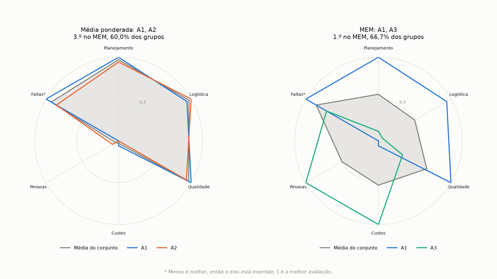
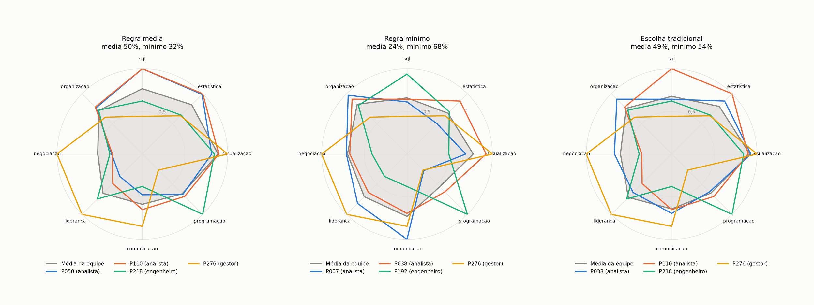

# mem-ga

*Leia em: [English](README.en.md)*

O Método de Escolha Múltipla (MEM) escolhe um conjunto de alternativas que se completam, em vez de pegar as melhores uma a uma. Serve para montar equipes, carteiras, comitês, qualquer escolha em que o grupo importa mais que cada parte.

Este repositório traz o método como um pacote Python, `mem`, com:

- as duas regras de nota: a da tese que propôs o MEM (`media`) e a adaptação da minha dissertação (`minimo`), com a mesma interface;
- duas buscas: testar todas as combinações, para problemas pequenos, e um algoritmo genético (MEM-GA), para os grandes;
- vagas por grupo (por exemplo, 2 analistas e 1 gestor), complementação e pesos calculados dos dados, e um gráfico de radar.

Dois exemplos fictícios de recrutamento mostram o uso: um pequeno, para acompanhar a conta, e um grande, com 300 candidatos. A aplicação em futebol, com os dados do Brasileirão 2017, fica no repositório [football-analytics](https://github.com/safsalles/football-analytics).

## Instalação

```bash
pip install git+https://github.com/safsalles/mem-ga@v1.0
```

Para mexer no código e rodar os testes, clone o repositório e, na pasta dele:

```bash
pip install -e ".[test]"
python -m pytest
```

## Uso

Com o repositório clonado, a partir da pasta dele (os dados do exemplo não vão junto com o `pip install`):

```python
from mem.busca import run_ga
from mem.problema import load_problem
from mem.regras import build_rule

problem = load_problem("exemplos/recrutamento-grande/data")
rule = build_rule(problem, "minimo", tau=0.54)
vagas = {"analista": 2, "engenheiro": 1, "gestor": 1}
result = run_ga(rule, problem.groups, vagas, size=4, seed=2026)
print(sorted(problem.alternatives[i] for i in result.team), result.score)
# ['P007', 'P038', 'P192', 'P276'] 0.6785714285714286
```

| Módulo | O que faz |
| --- | --- |
| `mem.problema` | `Problem` (alternativas, critérios, direção, pesos, grupos), `load_problem` para ler os CSVs e `normalize` |
| `mem.pesos` | Complementação calculada dos dados (1 − \|r\|, como no CRITIC, dentro de cada grupo) e pesos por grupo |
| `mem.regras` | As duas regras, `mean_rule` e `minimum_rule`, e `build_rule` para montar uma delas a partir de um `Problem` |
| `mem.busca` | `exhaustive` (todas as combinações), `run_ga` (algoritmo genético) e `traditional_choice` (os melhores de cada grupo, para comparar) |
| `mem.radar` | Gráfico de radar com um painel por conjunto |

## O método

1. **Normaliza as avaliações.** Cada critério vai para a faixa de 0 a 1, com 1 para a melhor avaliação. Nos critérios em que menos é melhor, a escala se inverte.
2. **Avalia o conjunto em grupos de critérios.** Para cada grupo de critérios, junta o desempenho do conjunto, os pesos e a complementação entre esses critérios num valor.
3. **Aplica o tau de corte.** O grupo de critérios conta 1 se o valor alcançar o tau, e 0 se não alcançar. É esse corte que impede um resultado muito alto de pagar um resultado baixo em outro grupo: o método não é compensatório.
4. **Dá a nota.** A nota é a fração dos grupos de critérios que alcançam o tau.

Com grupos de alternativas (cargos, posições), a complementação é calculada dentro de cada grupo, e cada grupo pesa mais os critérios em que se destaca.

## As duas regras

As duas recebem um conjunto e devolvem `(nota, desempate)`, por isso qualquer busca funciona com qualquer regra.

| | `media` (tese) | `minimo` (adaptação) |
| --- | --- | --- |
| Critérios | Combinados n a n, com n = tamanho do conjunto | Combinados 2 a 2 |
| Dentro do grupo de critérios | Média do desempenho (Equação 3.4 da tese) | Mínimo do desempenho |
| Nota | Fração dos grupos de critérios que alcançam o tau | Fração dos pares que alcançam o tau |
| Desempate | Média de `mínimo(valor, tau)` nos grupos | Média de `mínimo(valor, tau)` nos pares |

**Por que a adaptação.** Na tese, os critérios são combinados na mesma quantidade das alternativas escolhidas. Num conjunto grande, como 10 de 18 critérios, cada combinação fica perto da média geral do conjunto, e as diferenças entre conjuntos somem. Com os critérios 2 a 2, cada par ainda mostra o que o conjunto tem e o que falta. E, com o mínimo no lugar da média, um critério forte não cobre um fraco dentro do par, então o método fica não compensatório também ali.

**O desempate da regra `media` é novo.** Na tese, ela só rodava testando todas as combinações, e o empate ficava na mesma posição. O algoritmo genético precisa de um desempate para ter direção entre conjuntos com a mesma nota, então a regra `media` usa o mesmo desempate da `minimo`: quanto falta, em média, para os grupos alcançarem o tau.

**Limite da regra `media`.** O número de grupos de critérios é C(critérios, n). Com 18 critérios e um conjunto de 10, são 43.758 grupos por avaliação, lento demais para o algoritmo genético. Acima de 10.000 grupos (`MAX_MEAN_GROUPS`), a regra recusa o problema com uma mensagem que diz os números e sugere a regra `minimo`. Testar todas as combinações também tem limite: acima de 20 milhões de avaliações, a busca exaustiva recusa o problema.

## Exemplo pequeno: 2 de 8 candidatos

```bash
python exemplos/recrutamento-pequeno/exemplo.py
python exemplos/recrutamento-pequeno/exemplo.py --regra minimo
```

São 8 candidatos com notas em 6 critérios, e a busca testa todas as 28 duplas. Os candidatos A1 e A2 têm as melhores médias, mas são parecidos: fortes em planejamento, logística e qualidade, e medianos em custos e pessoas. O A3 é o contrário.

| Ordem | Média ponderada | MEM, regra `media` | % dos grupos | MEM, regra `minimo` | % dos pares |
| --- | --- | --- | --- | --- | --- |
| 1.º | A1 | A1, A3 | 66,7% | A1, A3 | 46,7% |
| 1.º | | A2, A3 | 66,7% | A2, A3 | 46,7% |
| 3.º | A2 | A1, A2 | 60,0% | A1, A2 | 33,3% |

A escolha tradicional fica com A1 e A2, os dois primeiros pela média ponderada. Nas duas regras, essa dupla fica em 3.º lugar, e as melhores juntam um deles com o A3, que cobre o que falta. Com tau 0,24, as duas regras concordam no ranking do topo. A regra `minimo` dá notas menores, porque cada par vale o critério mais fraco.

No radar, cada linha colorida é um candidato e a área cinza é a média da dupla. À esquerda, A1 e A2 quase se sobrepõem. À direita, A1 e A3 se completam.



O resultado depende do tau. Com a regra `media` e tau de 0,27 ou mais, o corte fica alto a ponto de só as notas muito altas de A1 e A2 passarem, e essa dupla volta ao 1.º lugar. Por isso o programa mostra o que muda com o tau um pouco acima e um pouco abaixo. Mais detalhes em [exemplos/recrutamento-pequeno](exemplos/recrutamento-pequeno/).

## Exemplo grande: equipe de 4 entre 300 candidatos

```bash
python exemplos/recrutamento-grande/exemplo.py
```

São 300 candidatos fictícios (150 analistas, 90 engenheiros e 60 gestores), com notas em 8 critérios, para uma equipe de 2 analistas, 1 engenheiro e 1 gestor. Seriam mais de 60 milhões de equipes possíveis, então a busca é feita pelo algoritmo genético. A execução leva cerca de 20 segundos.

| Equipe | Pessoas | Nota `media` | Nota `minimo` |
| --- | --- | --- | --- |
| Regra `media` | P050, P110 (analistas), P218 (engenheiro), P276 (gestor) | **50,0%** | 32,1% |
| Regra `minimo` | P007, P038 (analistas), P192 (engenheiro), P276 (gestor) | 24,3% | **67,9%** |
| Escolha tradicional | P038, P110 (analistas), P218 (engenheiro), P276 (gestor) | 48,6% | 53,6% |

A escolha tradicional pega os mais fortes de cada cargo. Cada regra acha uma equipe melhor que ela pela própria nota, e as duas regras escolhem equipes diferentes: a `media` troca um analista e fica perto da tradicional, e a `minimo` troca um analista e o engenheiro. A equipe da `minimo` perde um pouco em dados e programação e ganha em comunicação, negociação e organização: fica mais equilibrada, porque cada par de critérios vale o mais fraco dos dois. O gestor é o mesmo nas três.



O tau de cada regra foi escolhido para a nota não saturar: com o tau baixo demais, toda equipe passa em tudo; alto demais, ninguém passa. Testando de 0,01 a 1,00, ficou o valor em que a escolha tradicional chega mais perto de 50% (0,63 na `media` e 0,54 na `minimo`). Mais detalhes, e como os dados foram gerados, em [exemplos/recrutamento-grande](exemplos/recrutamento-grande/).

## Formato dos dados

`load_problem` lê uma pasta com estes arquivos:

- `criteria.csv`: `criterion`, `direction` (1 quando mais é melhor e 0 quando mais é pior) e `weight`.
- `alternatives.csv`: a coluna `alternative`, uma coluna por critério e, se houver vagas por grupo, a coluna `group`.
- `complementarity.csv` (opcional): a matriz de complementação entre critérios, com a diagonal vazia. Sem ela, a complementação é calculada dos dados.

## Conferência com a tese

A regra `media`, com a busca exaustiva, foi conferida com a aplicação numérica da tese, cujos dados não estão neste repositório. Na escolha de 2, com tau de 0,20, as 45 duplas do Quadro 3.9 bateram. Com tau de 0,19 e 0,21, 44 de 45 bateram nos Quadros 3.10 e 3.11, e a dupla diferente (A1, A8) tem um grupo de critérios a mais ou a menos. Na escolha de 3, os 40 conjuntos legíveis do Quadro 3.15 bateram. Os testes guardam o ranking do exemplo pequeno para que isso não mude sem aviso.

## Fonte

O MEM foi proposto na tese *Método de Escolha Múltipla: uma proposta multicritério para seleção em conjunto de mais de uma alternativa*, de Henrique Rego Monteiro da Hora (Universidade Federal Fluminense, 2013). A regra `minimo` e o algoritmo genético vêm da dissertação *MEM-GA: Método de Escolha Múltipla com Algoritmo Genético aplicado à formação de equipes de futebol*, de Sérgio Augusto Faria Salles (Instituto Federal Fluminense, 2018), escrita em MATLAB e trazida aqui para Python.
