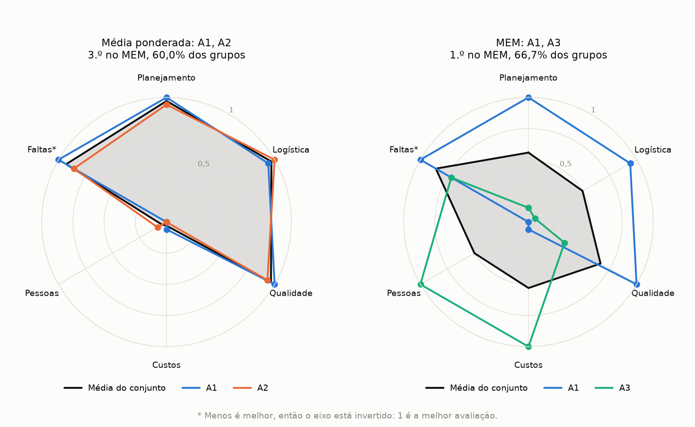

# MEM

*Read in: [Português](README.md)*

The Multiple Choice Method picks a set of alternatives that complement each other, instead of taking the best ones one by one. This folder holds the method as da Hora's thesis describes it, without a genetic algorithm: it tests every combination and shows the full ranking.

The data is fictional and small, so you can follow the math. The example follows the idea of the thesis's recruitment problem: choosing 2 of 8 candidates for two openings, with grades on 6 criteria.

## How to run

```bash
pip install -r requirements.txt
python mem.py
```

To change the number of choices, tau, or the length of the list, use `--choices`, `--tau`, and `--top`. To use other data, use `--data`.

```bash
python mem.py --choices 3 --tau 0.24 --top 5
```

At the end, the radar chart opens in a separate window, and the program ends when you close it. To save the chart to a file, use `--radar` with the file name, and to skip the window, use `--no-plot`.

```bash
python mem.py --radar images/radar.png
```

To run the tests, use `python -m pytest` in this folder.

## The method

Equation numbers are the ones in the thesis.

1. **Normalize the payment matrix (Equation 3.1).** Each criterion goes to the 0 to 1 range, with 1 for the best evaluation. For `Faltas` (absences), less is better, so the direction flips.
2. **Build the sets (Equations 3.2 and 3.3).** Alternatives and criteria are combined `n` by `n`, where `n` is the number of choices. With 8 alternatives, 6 criteria, and `n` equal to 2, that gives 28 sets and 15 criteria groups, or 420 evaluations.
3. **Compute matrix B' (Equations 3.4 and 3.5).** Each evaluation is the set's average grade on the group's criteria, times the average weight, times the average complementarity among those criteria.
4. **Apply the tau cutoff (Equation 3.8).** An evaluation counts as 1 if it reaches tau and 0 if it does not. This cutoff stops a very high result from paying for a low result in another group.
5. **Rank the sets (Equation 3.9).** The score is the share of criteria groups that reach tau. Ties share a position, because the method can point to more than one good choice.

The default tau is 0.24. It uses the thesis's rule: a 50% performance, times the average weight (0.75), times the average complementarity (0.647), gives 0.243.

## The example

Candidates A1 and A2 have the best averages, but they are alike: strong in planning, logistics, and quality, and average in costs and people. A3 is the opposite.

| Rank | Weighted average | | MEM, choosing 2 | % of groups |
| --- | --- | --- | --- | --- |
| 1st | A1 | | A1, A3 | 66.7% |
| 2nd | A2 | | A2, A3 | 66.7% |
| 3rd | A3 | | A1, A2 | 60.0% |

The weighted average column is the traditional choice: each candidate is rated alone, by the average of the normalized grades with the criteria weights, and the top of the list is kept. MEM does group formation and rates each pair together, by what each one covers for the other.

The intuitive choice would be A1 and A2, but that pair ranks 3rd in MEM. The two best pairs join one of them with A3, who covers what is missing.

The radar chart shows this. Each colored line is a candidate, with grades already normalized, and the gray area is the pair's average, which is what MEM evaluates. On the left, A1 and A2 almost overlap: the average goes above 0.9 on four criteria but stays near 0 in costs and people. On the right, A1 and A3 complement each other and the average stays between 0.5 and 0.86 on every criterion. The pair A2, A3 ties with A1, A3 and would look similar. The chart labels are in Portuguese, like the program's output.



The result depends on tau. At 0.28 or above, the cutoff is high enough that only the very high grades of A1 and A2 pass, and that pair returns to 1st place. That is why the program shows what changes with tau slightly above and slightly below, and the thesis runs the same sensitivity analysis.

## Data format

The three files live in `data/`, and criterion names must match across them.

- `alternatives.csv`: one row per alternative, with the `alternative` column and one column per criterion.
- `criteria.csv`: `criterion`, `direction` (1 when more is better and 0 when more is worse), and `weight`, between 0 and 1.
- `complementarity.csv`: matrix C. The higher the value, the more the two criteria complement each other. The diagonal stays empty.

## Check against the thesis

The program was checked with the data from the thesis's numerical application, which is not in this repository. Choosing 2 with tau 0.20, all 45 pairs in Table 3.9 matched. With tau 0.19 and 0.21, 44 of 45 matched in Tables 3.10 and 3.11, and the pair that differs (A1, A8) has one criteria group more or less. Choosing 3, the 40 legible sets in Table 3.15 matched.

## Why MEM-GA exists

Testing everything only works for small problems, because combinations grow very fast. Choosing 10 players out of 317, with 18 criteria taken 10 by 10, would give about 2.4 x 10^18 sets, each with 43,758 criteria groups. That is why the program refuses problems with more than 20 million evaluations.

[MEM-GA](../mem-ga/README.en.md) uses a genetic algorithm to search for a good set in those cases. It does not test everything, so it does not guarantee the best answer, and it makes two adaptations to the score, explained in its README.

## Source

The method comes from the thesis *Método de Escolha Múltipla: uma proposta multicritério para seleção em conjunto de mais de uma alternativa*, by Henrique Rego Monteiro da Hora (Universidade Federal Fluminense, 2013). The thesis's original code is a MATLAB script, in Annex III. This Python version follows the equations and that script.
