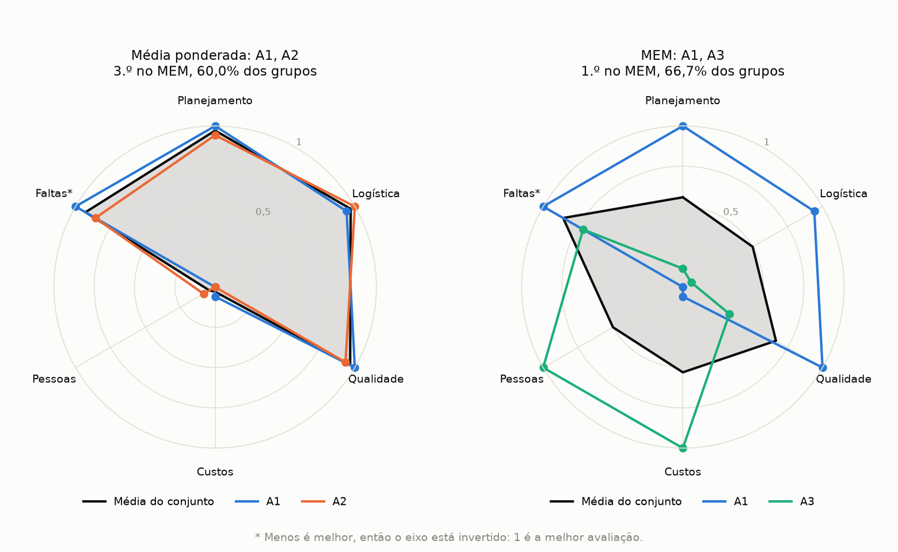

# MEM

*Leia em: [English](README.en.md)*

O Método de Escolha Múltipla escolhe um conjunto de alternativas que se completam, em vez de pegar as melhores uma a uma. Esta pasta traz o método como a tese de da Hora descreve, sem algoritmo genético: ele testa todas as combinações e mostra a ordem completa.

Os dados são fictícios e pequenos, para dar para acompanhar a conta. O exemplo segue a ideia do problema de recrutamento da tese: escolher 2 de 8 candidatos a duas vagas, com notas em 6 critérios.

## Como rodar

```bash
pip install -r requirements.txt
python mem.py
```

Para mudar a quantidade de escolhas, o tau ou o tamanho da lista, use `--choices`, `--tau` e `--top`. Para usar outros dados, use `--data`.

```bash
python mem.py --choices 3 --tau 0.24 --top 5
```

Para salvar o gráfico de radar, use `--radar` com o nome do arquivo.

```bash
python mem.py --radar images/radar.png
```

Para rodar os testes, use `python -m pytest` nesta pasta.

## O método

Os números das equações são os da tese.

1. **Normaliza a matriz de pagamentos (Equação 3.1).** Cada critério vai para a faixa de 0 a 1, com 1 para a melhor avaliação. Em `Faltas`, menos é melhor, então o sentido se inverte.
2. **Forma os conjuntos (Equações 3.2 e 3.3).** As alternativas e os critérios são combinados `n` a `n`, em que `n` é a quantidade de escolhas. Com 8 alternativas, 6 critérios e `n` igual a 2, são 28 conjuntos e 15 grupos de critérios, ou 420 avaliações.
3. **Calcula a matriz B' (Equações 3.4 e 3.5).** Cada avaliação é a média das notas do conjunto nos critérios do grupo, vezes a média dos pesos, vezes a complementação média entre esses critérios.
4. **Aplica o tau de corte (Equação 3.8).** A avaliação vale 1 se alcançar o tau, e 0 se não alcançar. É esse corte que impede um resultado muito alto de pagar um resultado baixo em outro grupo.
5. **Ordena os conjuntos (Equação 3.9).** A nota é a fração dos grupos de critérios que alcançam o tau. Empates ficam na mesma posição, porque o método pode apontar mais de uma boa escolha.

O tau padrão é 0,24. Ele usa a regra da tese: um desempenho de 50%, vezes a média dos pesos (0,75), vezes a média da complementação (0,647), dá 0,243.

## O exemplo

Os candidatos A1 e A2 têm as melhores médias, mas são parecidos: fortes em planejamento, logística e qualidade, e medianos em custos e pessoas. O A3 é o contrário.

| Ordem | Média ponderada | | MEM, escolha de 2 | % dos grupos |
| --- | --- | --- | --- | --- |
| 1.º | A1 | | A1, A3 | 66,7% |
| 2.º | A2 | | A2, A3 | 66,7% |
| 3.º | A3 | | A1, A2 | 60,0% |

A escolha intuitiva seria A1 e A2, mas ela fica em 3.º lugar no MEM. As duas melhores duplas juntam um deles com o A3, que cobre o que falta.

O radar mostra isso. Cada linha colorida é um candidato, com as notas já normalizadas, e a área cinza é a média da dupla, que é o que o MEM avalia. À esquerda, A1 e A2 quase se sobrepõem: a média passa de 0,9 em quatro critérios, mas fica perto de 0 em custos e pessoas. À direita, A1 e A3 se completam e a média fica entre 0,5 e 0,86 em todos os critérios. A dupla A2, A3 empata com A1, A3 e daria um desenho parecido.



O resultado depende do tau. Com 0,28 ou mais, o corte fica alto a ponto de só as notas muito altas de A1 e A2 passarem, e essa dupla volta ao 1.º lugar. Por isso o programa mostra o que muda com o tau um pouco acima e um pouco abaixo, e a tese faz a mesma análise de sensibilidade.

## Formato dos dados

Os três arquivos ficam em `data/`, e os nomes dos critérios precisam ser iguais nos três.

- `alternatives.csv`: uma linha por alternativa, com a coluna `alternative` e uma coluna por critério.
- `criteria.csv`: `criterion`, `direction` (1 quando mais é melhor e 0 quando mais é pior) e `weight`, entre 0 e 1.
- `complementarity.csv`: a matriz C. Quanto maior o valor, mais os dois critérios se completam. A diagonal fica vazia.

## Conferência com a tese

O programa foi conferido com os dados da aplicação numérica da tese, que não estão neste repositório. Na escolha de 2, com tau de 0,20, as 45 duplas do Quadro 3.9 bateram. Com tau de 0,19 e 0,21, 44 de 45 bateram nos Quadros 3.10 e 3.11, e a dupla diferente (A1, A8) tem um grupo de critérios a mais ou a menos. Na escolha de 3, os 40 conjuntos legíveis do Quadro 3.15 bateram.

## Por que existe o MEM-GA

Testar tudo só funciona em problemas pequenos, porque as combinações crescem muito rápido. Escolher 10 jogadores entre 317, com 18 critérios tomados 10 a 10, daria cerca de 2,4 x 10^18 conjuntos, cada um com 43.758 grupos de critérios. Por isso o programa recusa problemas com mais de 20 milhões de avaliações.

O [MEM-GA](../mem-ga/) usa um algoritmo genético para buscar um bom conjunto nesses casos. Ele não testa tudo, então não garante a melhor resposta, e faz duas adaptações na nota, explicadas no README dele.

## Fonte

O método vem da tese *Método de Escolha Múltipla: uma proposta multicritério para seleção em conjunto de mais de uma alternativa*, de Henrique Rego Monteiro da Hora (Universidade Federal Fluminense, 2013). O código original da tese é um script para MATLAB, no Anexo III. Esta versão em Python segue as equações e esse script.
